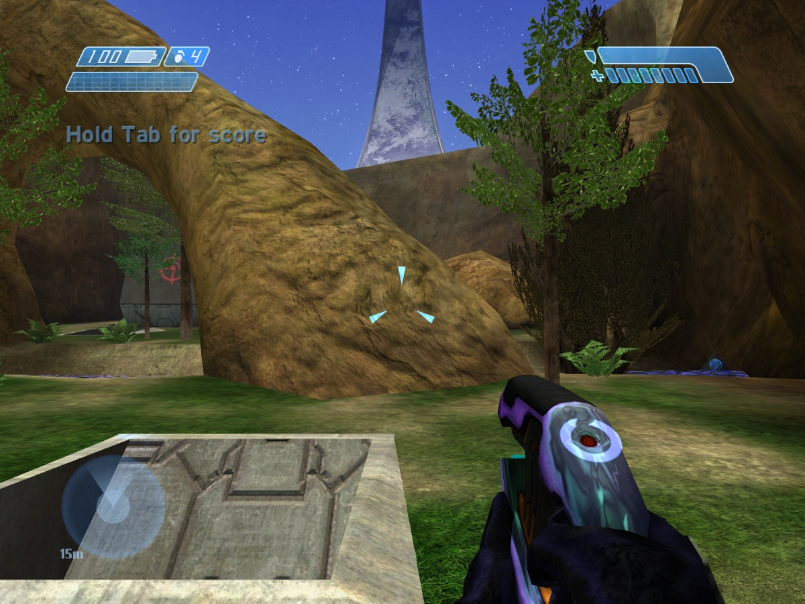
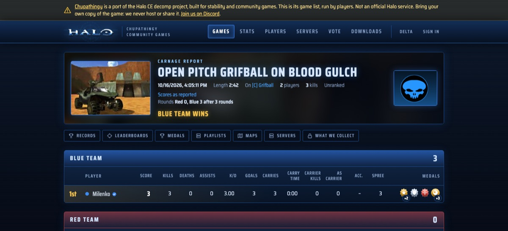
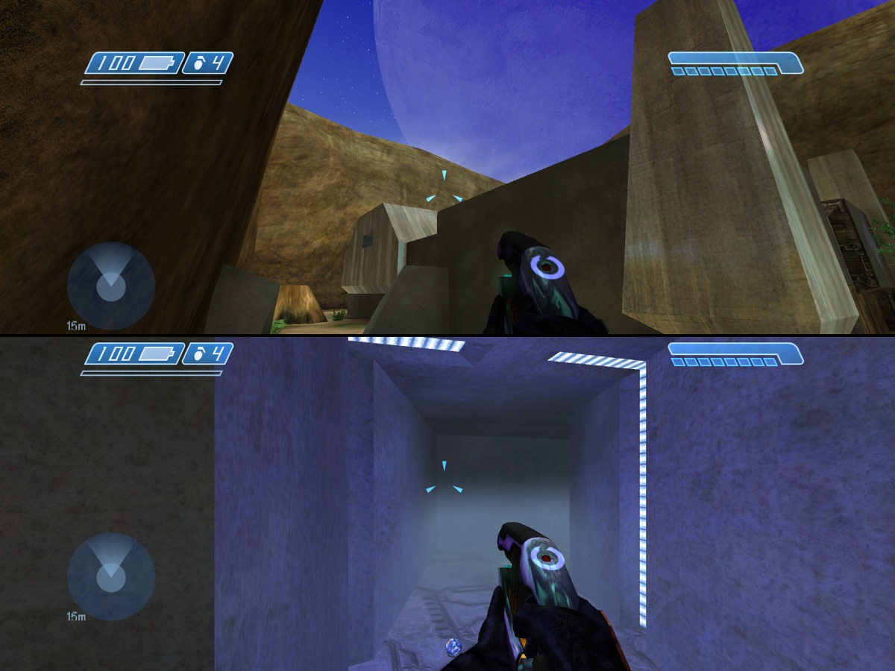
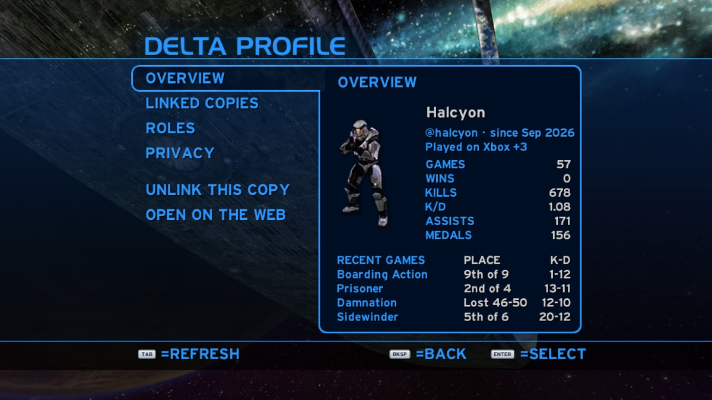
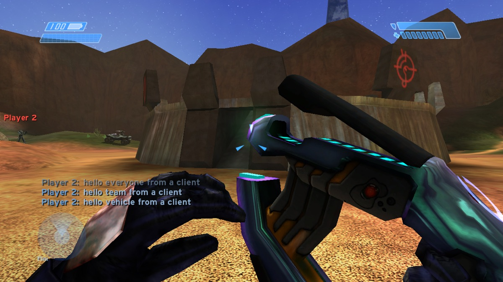
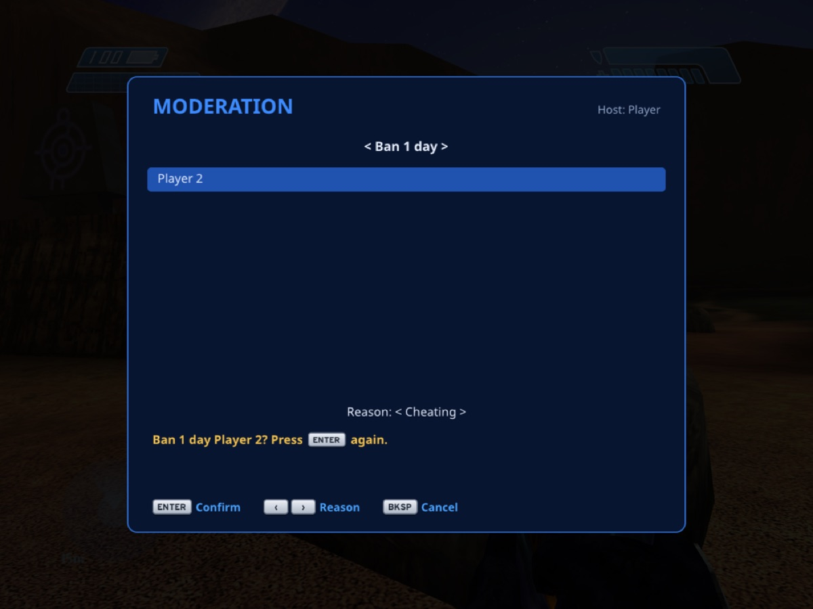
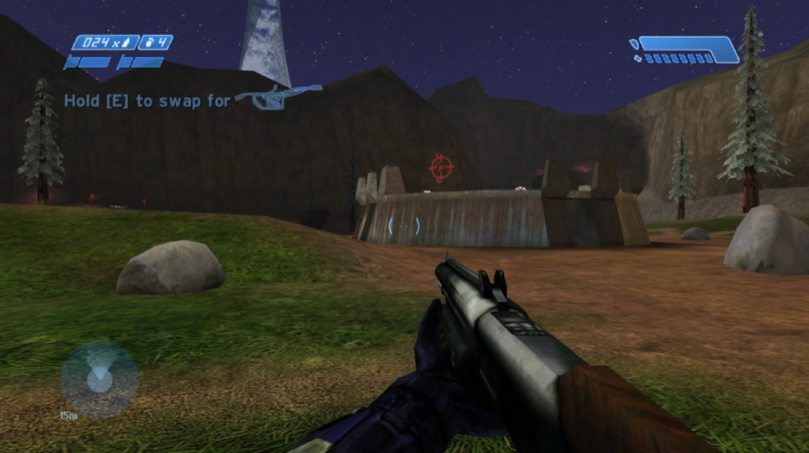
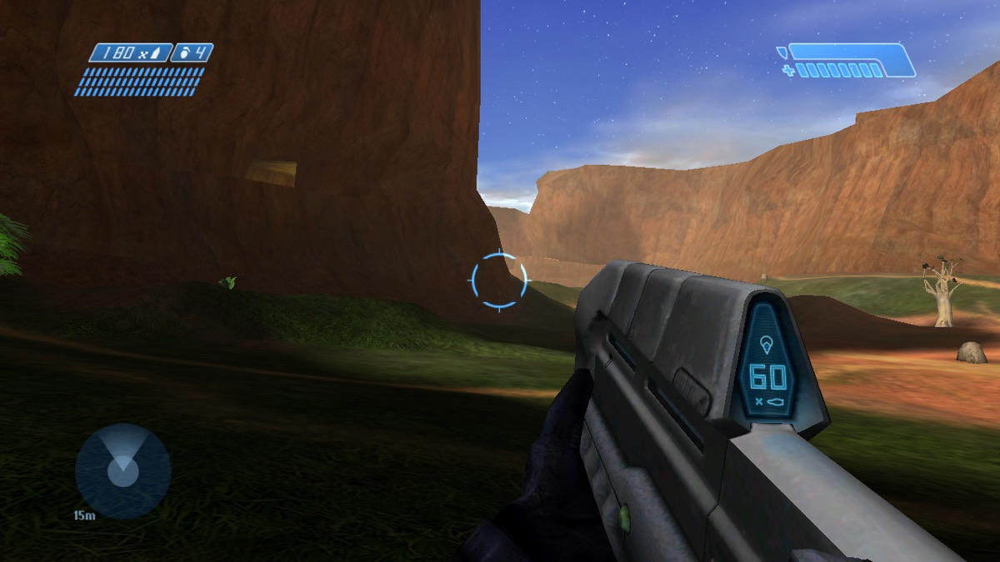
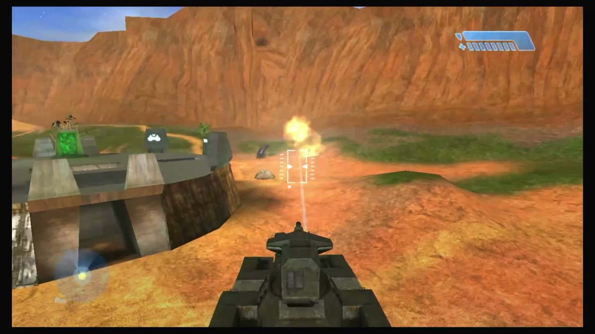

<p align="center"></p>

<h1 align="center">Chupathingy</h1>

<p align="center"><b>Halo CE: Ported for Everyone.</b></p>

<p align="center">


</p>

<p align="center">
<sub>IN TESTING</sub>&nbsp;


</p>

<p align="center">
<sub>COMMUNITY PORTS</sub>&nbsp;


</p>

<p align="center">
<a href="https://github.com/ChupathingyCE/chupathingyce/releases/latest">Download</a> ·
<a href="https://chupathingy.org">chupathingy.org</a> ·
<a href="https://stats.chupathingy.org">Games online now</a> ·
<a href="https://discord.gg/chupathingy">Discord</a>
</p>

<p align="center">
<a href="LICENSE"></a>
<a href="https://github.com/ChupathingyCE/chupathingyce/releases/latest"></a>
<a href="https://discord.gg/chupathingy"></a>
</p>

<p align="center"></p>

Play Halo: Combat Evolved on your PC, Mac, Steam Deck or phone. Campaign, split screen, System Link, and online games with players on every platform.

It plays like the Xbox game. Everything extra is a setting.

You need your own copy of the game. Chupathingy never includes or downloads Microsoft's files.

## Get it

Download the latest release from the [Releases page](https://github.com/ChupathingyCE/chupathingyce/releases/latest).

| System | Download |
| --- | --- |
| Windows 10 or later | `chupathingyce-windows64-release.zip` |
| Mac, Apple silicon or Intel | `chupathingyce-macos-release.zip` |
| Linux, Steam Deck too | `chupathingyce-linux64-release.AppImage` |
| Android 9 or later | `chupathingyce-android-release.zip` |
| FreeBSD | `chupathingyce-freebsd64-release.zip` |

Older 32-bit PCs, the Linux zip and the other ways to install are in [docs/install.md](docs/install.md).

The game checks for updates when it starts and asks before installing one. It only installs updates we've signed. On a Mac, it opens the download page instead.

**First start on Windows.** If Windows warns about an unknown publisher, choose **More info**, then **Run anyway**.

**First start on a Mac.** Move ChupathingyCE to Applications and open it. If macOS won't open it, go to **System Settings > Privacy & Security** and choose **Open Anyway**. You only do this once.

## Set it up

1. Start Chupathingy.
2. Pick your Halo: Combat Evolved disc image (`.iso` or `.xiso`) from the original Xbox. Any region works.
3. Wait while it copies the maps (about 2 GB). Then you're in.

Have Halo PC or Custom Edition? The same screen takes the Halo PC disc and the Custom Edition installer too. See [docs/maps.md](docs/maps.md).

On Android, copy the disc image to your phone first.

Where your maps, settings and saves go: [docs/install.md](docs/install.md#where-your-files-go).

## Play online

- **Join a game.** Open **Multiplayer > Online Games**, pick a game and press **A**. Or press **Join** on [stats.chupathingy.org](https://stats.chupathingy.org).
- **Host a game.** In Online Games, press **Y** to create one. Everyone can see it on the list.
- **Invite a friend.** Send them your game's invite link.
- **Play the campaign together.** Host it online from Create Game. [Here's how](docs/online.md#online-co-op).

Chupathingy players on every platform play together. **Compatible with OpenCE build-314 (network version 39) for online play:** their players can join your games, and you can join theirs.

Friends can't get into your game? See [docs/online.md](docs/online.md#if-friends-cant-join).

<p align="center">


</p>

## Features

**Playing together**
- An Online Games list in the Multiplayer menu
- Our servers around the clock, plus the community's
- Split screen for up to four, and System Link with no internet or account
- Online co-op through the campaign
- Text chat, and host tools to kick or ban

**Maps**
- Every Xbox map from your disc
- Halo PC, Custom Edition and HaloMD maps, side by side with the Xbox ones
- Missing Custom Edition maps download when you join
- Community Xbox map packs, like Halo CE+

**Your stats**
- A carnage report with medals for every finished game
- Service records and leaderboards on [stats.chupathingy.org](https://stats.chupathingy.org)
- Your Delta profile, right in the game

**How it looks and feels**
- The Xbox menus, with Halo PC's settings added
- High-res HUD and text, and widescreen
- Controller layouts, Bumper Jumper included, with button prompts for Xbox, PlayStation and Nintendo pads
- 5.1 and 7.1 surround, and a headphone 3D mode
- The intro and cutscene movies from your disc

<p align="center">



</p>
<p align="center">



</p>

Every setting, and the `config.toml` file behind them: [docs/settings.md](docs/settings.md). What each platform has: [docs/builds.md](docs/builds.md).

## Consoles

Chupathingy also runs as homebrew on consoles, in the same online games as everyone else. They're test builds for now.

| Console | Get it |
| --- | --- |
| Original Xbox | [warthog-xbox](https://github.com/ChupathingyCE/warthog-xbox). Test builds are on the [Discord](https://discord.gg/chupathingy). |
| Xbox 360 | [warthog-360](https://github.com/ChupathingyCE/warthog-360). Test builds are on the [Discord](https://discord.gg/chupathingy). |
| Wii U | [warthog-wiiu](https://github.com/ChupathingyCE/warthog-wiiu/releases) |
| Nintendo Switch | [warthog-switch](https://github.com/ChupathingyCE/warthog-switch/releases), by thelinkin3000 |

Other developers have ported it to the PSP, PS Vita, PS3, PS4, PS5 and Xbox Series (UWP). They play in the same games.

<p align="center">


</p>

## Run a server

The dedicated server runs a playlist of games around the clock. It runs on Linux (x86, x64 or arm64, Raspberry Pi too) or in Docker, and needs no port forwarding. Start with [server/README.md](server/README.md).

## Builds

Releases are the stable builds, and the game updates itself from them. Want the newest changes early? Try the [nightly build](https://github.com/ChupathingyCE/chupathingyce/releases/tag/nightly). More in [docs/install.md](docs/install.md#which-build).

## Help

Ask on the [Discord](https://discord.gg/chupathingy). It's also where people find games and report bugs. You can file bugs in [issues](https://github.com/ChupathingyCE/chupathingyce/issues) too. Attach `logs/debug.txt` from the game's folder.

## Build it yourself

You need Python 3, [ninja](https://ninja-build.org/) and clang. You don't need the Xbox SDK.

```sh
python3 configure.py
ninja
```

Every target and option is in [docs/building.md](docs/building.md).

## Where it came from

Chupathingy is a port of the Halo: Combat Evolved decompilation ([punpckhdq/halo](https://github.com/punpckhdq/halo) and [bnunu/halo-1](https://github.com/bnunu/halo-1)). It began as a fork of OpenCE, an earlier port of that decompilation (the code is theirs up to October 9, 2026), and has had its own code, releases and community since. The people whose work it builds on are named in [Credits](#credits).

## Generative AI

The decompilation this project is built on, and the port it began as a fork of, were made with heavy use of generative AI. Chupathingy has its own code and releases now, but a lot of that earlier work is still in it.

We use AI tools the way developers use any other tool. A person decides what to build, reviews every change, tests it, and is responsible for it. Nothing is handed to an AI to build from start to finish without a person involved. We're also working through the code we inherited to clean up what reads as machine-written: comments that only repeat the code, unclear names, and changes nobody can explain.

If you contribute, the same applies to you: see [CONTRIBUTING](CONTRIBUTING.md#using-ai-tools).

## License

Chupathingy is free software under the GNU General Public License, version 3 or later. It comes with no warranty. Releases up to 0.7.5d stay under CC0. The details, and the permission for console SDKs, are in [docs/license.md](docs/license.md).

The license covers Chupathingy's code only. It gives no rights in Halo or anything else Microsoft owns.

## Support

Chupathingy is free and always will be. Support through
[Ko-fi](https://ko-fi.com/milenko) goes to running the site and the servers. If
there's a specific developer or port you'd like to support, ask them: they may
not be part of our community.

## Credits

- The decompilation: [punpckhdq/halo](https://github.com/punpckhdq/halo) and
  [bnunu/halo-1](https://github.com/bnunu/halo-1), of the Xbox build 2342.
- The port Chupathingy began as a fork of: OpenCE and its contributors, up to
  October 9, 2026 (see [Where it came from](#where-it-came-from)).
- Later fixes taken from OpenCE (CC0), with their authors kept in the
  history: startupfoundry, xshxdex98, hkmodd, eltanschauung, justinfilip,
  bertoaldo, MrBruh, addisonbair, thelinkin3000, bmanturner and chestahh (by
  their GitHub handles). The wire format tool (`tools/network_format.py`) is
  addisonbair's and MrBruh's.
- Chupathingy: [Milenko](https://github.com/MrMilenko) and contributors. The
  icon is MrBruh's helmet, with tusks.
- Fonts: Cyborg Interface Gothic, the high-res text's font, by fizzy, made
  to match Halo's interface font from Overpass and glyphs of their own
  (SIL OFL); [Overpass](https://github.com/RedHatOfficial/Overpass) (SIL OFL);
  [Noto Sans](https://fonts.google.com/noto) (SIL OFL) and
  [Kenney's Input Prompts](https://kenney.nl/assets/input-prompts) (CC0); the
  scoreboard's platform logos are one-color marks from
  [Simple Icons](https://simpleicons.org) (CC0) and Wikimedia Commons (public
  domain), plus our own Xbox 360 ring and Wii U GamePad; the names and logos
  are their owners' trademarks, used only to identify platforms. The same
  marks make the platform badges at the top of this page.
- Controller button icons by snapchipper, CC0 (`port/assets/prompts`).
- Headphone 3D sound (`audio.hrtf`): head-related impulse responses from the
  [SADIE II database](https://www.york.ac.uk/sadie-project/database.html)
  (KEMAR, subject D2), University of York, Apache License 2.0
  (`port/assets/hrtf`).
- High-res HUD art on the Xbox maps: Aerocatia's and Jessie's HUD art from
  [Halo PC Restored](https://github.com/Aerocatia/halopc-restored) (release
  r220), used with Aerocatia's permission on the condition that both are
  credited; `port/assets/hud/NOTICE.md` lists which files are theirs.
- HD HUDs on Custom Edition maps (MCC's "0.5 HUD scale" and Chimera's
  "force HUD use high resolution scale" flags): ugoboom, tested with
  Aerocatia's [halopc-restored](https://github.com/Aerocatia/halopc-restored)
  resource maps.
- Grifball courts: Bomb plays on SlappyThePirate's "Grifball Beta" court
  (`grifball.map`), which is open to use with credit; the map is not
  included.
- HaloMD map names: from [MacGamingMods](https://macgamingmods.com)' public
  HaloMD mod list, so the menus can show each map's own name.
- Missing Custom Edition maps: downloaded from the community map
  repositories, as Chimera uses them (maps.halonet.net, the HAC2 map
  repository, and its mirrors). Chupathingy's downloader is its own code;
  Chimera showed where the repositories are and how they answer.
- [Chimera](https://github.com/SnowyMouse/chimera) by SnowyMouse and
  contributors (GPL-3.0): Halo PC fixes reference and the compressed map
  format.
- Security reports: nickarcade, who reported the dedicated server's control
  panel permission gap fixed in #462.
- Libraries: SDL3, stb, Mbed TLS, miniupnpc, KCP, tomlc17, musl's maths,
  Expat, Monocypher, zlib, Zstandard, SMAA, and Project Nayuki's QR Code
  generator. Their licenses are
  beside them in `port/third_party`.

<details>
<summary><b>Contributors</b></summary>

Fixes from other people's pull requests and forks, taken into Chupathingy
with their authors credited in each commit.

- [Tyberious](https://github.com/Tyberious) (Jeff Clark): Xbox ADPCM decoding
  without the 344 Hz buzz, vertex constant serials that never wrap, pose
  snapping for frame interpolation, and the clip-space position kept on the
  desktop (no more first-person vertex spikes).
- [thelinkin3000](https://github.com/thelinkin3000): the motion sensor for
  three and four local players (a split screen crash), and split screen
  dividers where the views meet on a wide screen.
- [xshxdex98](https://github.com/xshxdex98) ([DamnationCE](https://github.com/xshxdex98/DamnationCE)):
  the pause menu's QUIT by mouse or keyboard, and lens flares out of view no
  longer tested.
- [zimm3rmann](https://github.com/zimm3rmann): visibility test slot 0 kept
  apart from the scratch query (lens flares sharing a result).
- [nsafran1217](https://github.com/nsafran1217) (Nathan Safran): no hang
  where the visibility results buffer cannot be mapped.
- [saulob](https://github.com/saulob): the first menu frame's colors.
- [natsu-anon](https://github.com/natsu-anon): the cursor hidden during play.
- [lantos1618](https://github.com/lantos1618): no ghosting in the zoom effect
  at high resolutions; on macOS, Command-W does not quit and Command-Q asks
  twice.
- [pfista](https://github.com/pfista) (Michael Pfister): projectile trails
  ready before a weapon's first shot.
- [JoshRob297](https://github.com/JoshRob297): hosts that run their own games
  (the dedicated servers) no longer refuse every join after one arrived as a
  game ended.
- [HiIAmMoot](https://github.com/HiIAmMoot) (Mootjuh): the Android menus by
  touch, and starting a multiplayer game alone (`game.start_with_one_player`,
  first `debug.solo_game`), now on by default.
- [oatkrs](https://github.com/oatkrs) (Utkarsh): crisp windowed rendering and no
  audio cut-outs on macOS, and a corrupted script thread dropped instead of
  halting the game.
- [Renkoto](https://github.com/Renkoto): the FreeBSD port (`port/unix`,
  `ninja freebsd64`) and its Delta platform, 13.

</details>

<details>
<summary><b>Findings and testing</b></summary>

- [bnunu](https://github.com/bnunu): Custom Edition map
  findings from the custom-edition-maps branch, credited in the commits they
  led to, and the larger texture cache for Halo PC maps, which that branch had
  first.
- Sabriel and ugoboom: the Halo PC map reports and regression lists behind
  most of the Custom Edition fixes.
- Sabriel, roundzabout and Mega: Grifball playtesting and the bugs and
  tweaks it turned up.
- MrBruh (build-145's Custom
  Edition loader, from DamnationCE's work by
  [xshxdex98](https://github.com/xshxdex98)): maps that need OpenSauce refused
  with a clear reason, the missing-map message when joining, and the
  `custom_maps\<name>` naming our hosts and clients share with OpenCE.

</details>

---

<sub>Chupathingy is an unofficial fan project. It isn't affiliated with or endorsed by Microsoft, Xbox Game Studios, Bungie or Halo Studios. Halo is a trademark of Microsoft. No game files are included: you bring your own copy. The code is released under the GNU GPL, version 3 or later (see [License](#license)).</sub>
