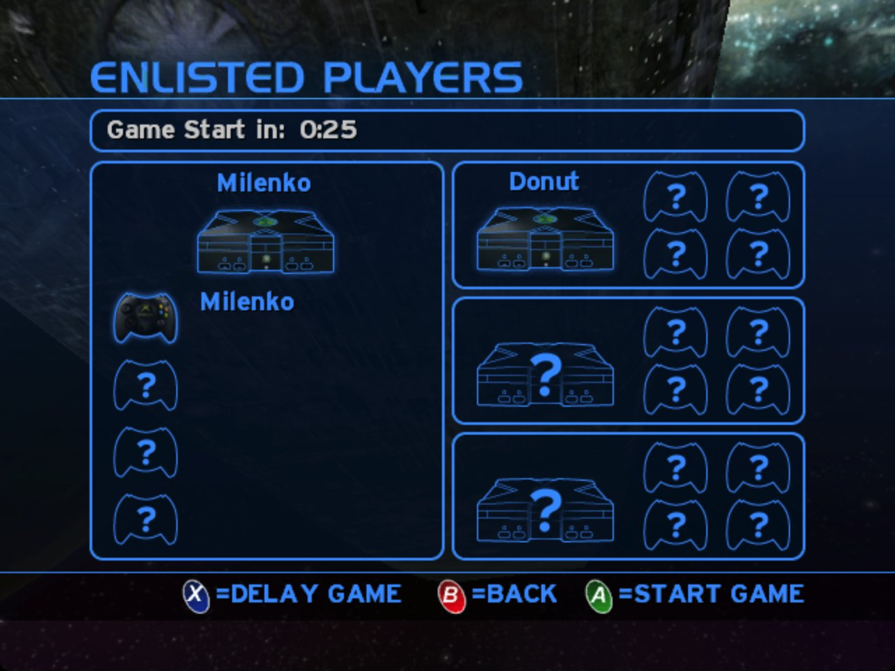
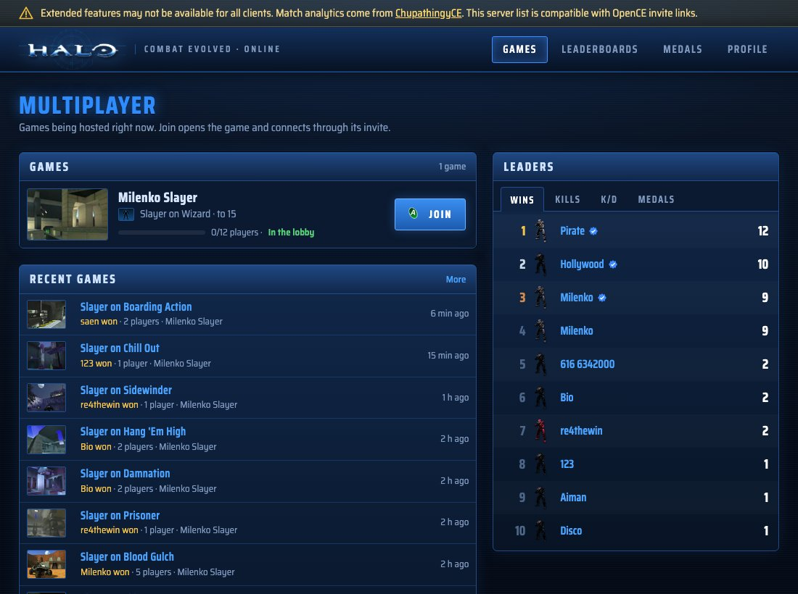
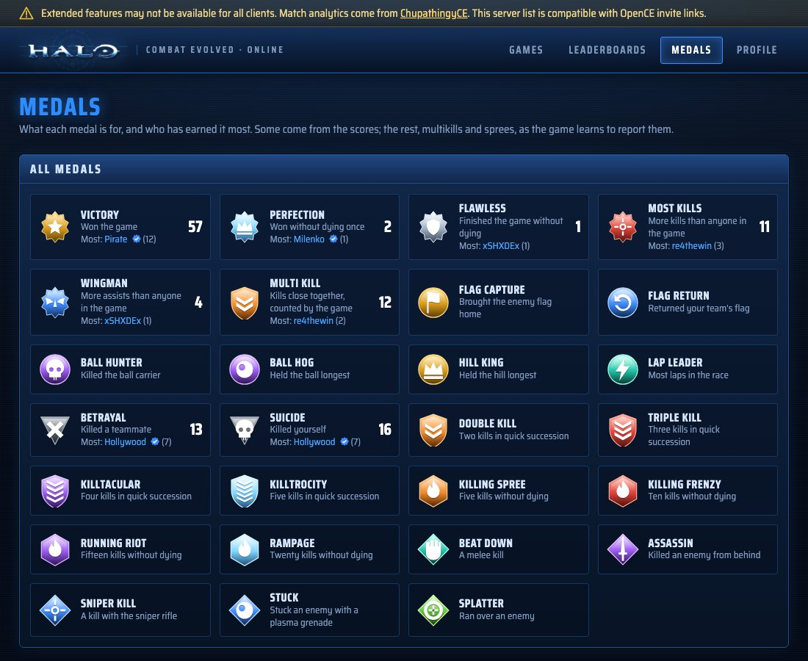

<p align="center"></p>

<h1 align="center">Chupathingy</h1>

<p align="center"><b>Halo: Combat Evolved on Mac, Linux, Steam Deck, Windows and Android: a native port of the Halo CE decompilation, built for stability and community games.</b></p>

<p align="center">
<a href="https://chupathingy.org">chupathingy.org</a> ·
<a href="https://github.com/ChupathingyCE/chupathingyce/releases/latest">Download</a> ·
<a href="https://stats.chupathingy.org">Games online now</a> ·
<a href="https://discord.gg/chupathingy">Discord</a>
</p>

> **Compatible with OpenCE build-206 (network version 29) for online play.** Players on that build join our games, and ours join games hosted on network versions 11 through 30. Browser builds can't join our games, nor we theirs.

Chupathingy is a free, open-source port of the Halo: Combat Evolved
decompilation (Halo CE) to modern computers and phones. It runs natively on
Windows, Mac (Apple silicon and Intel), Linux (including Steam Deck) and
Android, with no emulator, and is built for stability and community games:
releases you can count on, dedicated servers, an in-game server browser,
stats, and its own network layer, Delta. Bring your own copy of the game: we
never host or share Microsoft's files. Expect rough edges, and please report
them. Website: [chupathingy.org](https://chupathingy.org). Chat and find
games to join: [discord.gg/chupathingy](https://discord.gg/chupathingy).

<p align="center"></p>

## What ChupathingyCE is and isn't

- A port of the Halo: Combat Evolved decompilation for Windows, Mac, Linux
  and Android, run by its community.
- You bring your own legally owned copy of the game. We never host, share or
  distribute Microsoft's files, and the game never downloads them.
- No browser version, and no websites or domains that look official.
- A fan project, not made or endorsed by Microsoft, Bungie or 343 Industries.

## Features

**Online**
- **Online Games**, a server list in the Multiplayer menu: join a game with **A**, or host one with **Y**
- A game its host lists once for each network version shows once there, and its players count once (this fork: `merge_listings` in `port/linux/src/browser.c`)
- Games you host are listed for everyone, from any of our builds
- Invite links (`halo://join/…`) to send to friends; opening one joins their game
- Direct connections between players, with no port forwarding in most homes
- Cross-play with players on other builds of the same network version, both ways
- Dedicated servers anyone can run: a playlist of games, around the clock, on Linux x86, x64 or arm64

**Stats, on [halo.milenko.org](https://halo.milenko.org)**
- A carnage report for every finished game, with medals
- Service records and leaderboards, with confirmed players (your games count toward you, whatever name you use)
- Accounts, made on the site or from the game, with an encrypted backup of your player identity
- Listing a game hosted from another build, by its invite link

**The game**
- The campaign, split screen and System Link, running natively (no emulator)
- LAN parties the old way: System Link on your own network and split screen need no internet and no account
- High-res HUD and text, and widescreen menus
- Controller prompts for Xbox, PlayStation and Nintendo pads, and the keyboard
- Updates itself on Windows, Linux and Android: it checks for new releases when it starts, and asks first (on Mac it opens the download)

**Platforms**

| | Windows | Mac | Linux | Android |
| --- | --- | --- | --- | --- |
| The game | Yes | Yes, Apple silicon and Intel | Yes | Yes |
| Online Games, hosting, stats | Yes | Yes | Yes | Yes |
| Dedicated server | The game, for a test | The game, for a test | Yes: x86, x64 and arm64, and Docker | |
| Updates itself | Yes | Not yet | Yes | Yes |
| Halo PC (Custom Edition) maps | Yes | Yes | Yes | Yes, see below |
| HaloMD maps | Yes | Yes | Yes | Yes, see below |
| Server Browser in the PC menus | Yes | Yes | Yes | Yes |

## Download

Get the latest release from the [Releases page](https://github.com/ChupathingyCE/chupathingyce/releases/latest):

| Platform | Download | Notes |
| --- | --- | --- |
| Windows | `chupathingyce-windows-release.zip` | Windows 10 or later. |
| Linux (64-bit) | `chupathingyce-linux64-release.zip` | glibc 2.31 or later (Debian 11, Ubuntu 20.04). Brings its own SDL3. See [port/linux/README.md](port/linux/README.md). |
| Linux (32-bit, older systems) | `chupathingyce-linux-release.zip` | glibc 2.31 or later (32-bit). Brings its own SDL3. See [port/linux/README.md](port/linux/README.md). |
| Android | `chupathingyce-android-release.zip` | Android 9 or later, 64-bit. See [port/android/README.md](port/android/README.md). |
| Mac | `chupathingyce-macos-release.zip` | macOS 13 or later, Apple silicon or Intel. |

The game checks for new releases when it starts and asks before updating.

We don't pay for code signing yet, so the first start needs one extra step:

- **Windows** may warn about an unknown publisher: choose **More info → Run anyway**.
- **Mac**: move ChupathingyCE to Applications and open it. If macOS won't open
  it, go to **System Settings → Privacy & Security**, and choose **Open
  Anyway** next to ChupathingyCE. You only do this once.

## You need your own copy of Halo

ChupathingyCE doesn't include the game's maps, sounds or art. You need an Xbox
disc image (`.iso` or `.xiso`) of Halo: Combat Evolved. Any region works.

1. Start ChupathingyCE.
2. The first time, it asks for your disc image. Pick it.
3. It copies the game's `maps` folder out of the image (about 2 GB), then starts.

On Android, copy the disc image to your phone first; the maps, settings and
saves go in `/sdcard/Android/data/dev.horrible.chupathingyce/files`. On a
Mac, the maps, settings and saves go in
`~/Library/Application Support/ChupathingyCE`.
On Linux, the maps and settings (`config.toml`) go next to the `halo`
executable, and the saves in `~/.local/share/chupathingyce` (or
`$XDG_DATA_HOME/chupathingyce`). On Windows, the saves go in
`%APPDATA%\ChupathingyCE`. The first start copies your profiles, saved games
and game types from the folder earlier versions used (`halo-linux`, or
`%APPDATA%\halo` on Windows), which is left as it was. The 64-bit and
32-bit builds use the same places, so switching from one to the other keeps
your saves and settings.

**Common mistake:** the `maps` folder must hold the Xbox maps from your disc
image, not Halo PC's. Halo PC maps go in folders of their own beside it:
`maps_ce`, `maps_md` and `maps_pc` (see below). On a Mac, Linux and
Windows, if `maps` holds Halo PC maps or has no `ui.map`, the game says so
and quits.

## Halo PC maps

Every ChupathingyCE build also plays Halo PC multiplayer maps: Windows
(32-bit and 64-bit), Mac, Linux (32-bit and 64-bit), Android and the
dedicated server. Each kind has a folder of its own beside the game's
`maps` folder:

| Folder | What goes in it | Played online as |
| --- | --- | --- |
| `maps_ce` | Halo PC Custom Edition maps, with Custom Edition's `bitmaps.map`, `sounds.map` and `loc.map` | `<name>@ce` |
| `maps_md` | HaloMD maps (below) | `<name>@md` |
| `maps_pc` | the maps of your own Halo PC (retail) disc | `<name>@pc` |

Where the game's `maps` folder is:

| Platform | The folder holding `maps`, `maps_ce`, `maps_md` and `maps_pc` |
| --- | --- |
| Mac | `~/Library/Application Support/ChupathingyCE/` |
| Linux | next to the `halo` executable |
| Windows | next to `halo.exe` |
| Android | `/sdcard/Android/data/dev.horrible.chupathingyce/files` |

Copy the `.map` files from your own Halo PC install. On Android, Import
maps (hold the app's icon, or the touch controls' Options in the game)
picks `.map` files or `.zip` archives with Android's own file picker and
puts each in its folder. Include `bitmaps.map`,
`sounds.map` and `loc.map` from Custom Edition in `maps_ce`: every Halo PC
map reads them. Halo PC's own `ui.map` there adds its map names and
pictures. The maps appear in the multiplayer map list after the Xbox maps,
marked [CE], [MD] or [PC]. In Online Games, a game on a Halo PC map is
badged, and it can be joined only by players who have that map: the game
says which file is missing and where it goes. The Xbox maps from your disc
image are still needed. ChupathingyCE doesn't come with any of these files.

**Playing with other builds.** Other builds play Custom Edition maps from
a `custom_maps` folder. A game on a Custom Edition map is named the same way
for both, so their players with the map join our games and we join theirs.
HaloMD and Halo PC retail games are ChupathingyCE's only: a player on
another build is told the map is missing. Between ChupathingyCE players,
the map's identity (its name and a hash of its file) is checked, so a
player with a different file of the same name is told so.

**Downloading a missing map.** When a game you join is on a Custom Edition
map you don't have, the game offers to download it from the community map
repositories (the public map repositories Halo PC players have used for
years, as Chimera downloads from them: maps.halonet.net, then its mirrors
maps2 and maps1, over HTTPS): "Download <name>.map from the community map
repository?", with Yes, No and Don't ask again. The download shows its
progress and can be cancelled. Before the map goes in `maps_ce`, the game
checks it: no more than 200 MB, downloaded and unpacked; only `<name>.map`
taken from the archive, never a path from it; its size and CRC-32 as the
archive states them; a Custom Edition multiplayer map whose header names the
map asked for; and the host's version of it (the checksum in its header,
which the host advertises with its game). It never replaces a file that is
there. Then the game joins, and the map's own checks run as for any map. A
downloaded map is listed in `maps_ce/downloaded_maps.txt`: its scripts are
held to a downloaded map's tighter rules. `network.map_downloads` in
`config.toml` (or Network Settings in the PC menus) says `"ask"` (the
default), `"always"` or `"never"`. Desktop and Android builds download maps;
the dedicated server doesn't. HaloMD and Halo PC retail maps aren't
downloaded, and neither are Halo PC's own maps and files (Blood Gulch, Putput,
the campaign's levels, `ui`, `bitmaps` and the rest, also under a hashed
name), though the repositories have copies: they're Microsoft's and
Gearbox's, so the game asks you to copy them from your own Halo PC or Custom
Edition install instead ("Install this map yourself").

**When the host changes map.** If a game you're in moves on to a Custom
Edition map you don't have (a dedicated server's playlist going to its next
map, say), the game leaves it, offers the map the same way over the main
menu (or downloads it at once, with `"always"`), and then joins the same host
again, in its next lobby or the game in progress. The game's protocol gives a
machine about a minute to load a map before the host drops it, too short for
most downloads, so the player leaves and comes back rather than holding the
game up. If the map isn't downloaded (you say no, cancel it, or it fails),
the main menu says the map is missing, as it does with `"never"`.

**Maps named with a hash.** Hosts on some other builds name a shared Custom
Edition map `<name>_<8 hex digits>` (a game on `Sneak_af352483`, say), the
digits the start of a hash of the whole map file. ChupathingyCE plays such a
game from your `<name>.map` (`sneak.map`) when its hash matches, and the
downloader fetches `<name>.map` for it, checking the hash too. If your
`<name>.map` is another version, the download is kept beside it as
`<name>_<digits>.map`.

**Older folders.** Earlier ChupathingyCE versions kept Custom Edition maps
in `maps/ce/` and HaloMD maps in `md_maps/`, and other builds keep their Custom
Edition maps in `custom_maps/`. The game still plays the maps in all three.
At its first start it offers to move `maps/ce/` to `maps_ce` and `md_maps/`
to `maps_md` (each folder is moved whole: nothing is copied or deleted, and
a folder that can't be moved stays where it is). `custom_maps/` is other builds'
and stays where it is. `game.move_old_map_folders` in `config.toml` says
`"ask"`, `"yes"` or `"no"`; Android moves them without asking. A map file
named `<name>@ce.map` (`@md`, `@pc`), as some other builds name them, is
found in its folder or in `maps/` itself.

**Common mistake:** don't point `maps` itself at a Halo PC maps folder, or copy
Halo PC maps straight into it. The game can't start with Halo PC's `ui.map`
in place of the Xbox one, and Halo PC maps in `maps/` itself don't play. Keep
the Xbox maps in `maps/` and the Halo PC maps in `maps_ce`, `maps_md` or
`maps_pc`.

On Android, two limits apply. The maps need a fixed 23 MB of the app's
memory, which Android's Java runtime takes on some devices with a very large
Java heap (more than about 700 MB, such as some gaming handhelds). There
the Halo PC maps are not listed, and the log says `cannot reserve Custom
Edition maps' tag cache`. And the phone's texture cache is smaller than a
computer's, so on the heaviest maps (Foundation) some surfaces can show the
wrong textures in their busiest views. See [port/android/README.md](port/android/README.md).

### HaloMD maps

ChupathingyCE also plays HaloMD's multiplayer maps (the Mac Halo community's
maps, made for Halo PC 1.0), in every build. Bring your own: download
the maps you want from HaloMD's mod list, and put their `.map` files in
`maps_md`, beside the game's `maps` folder.

They need Custom Edition's `bitmaps.map`, `sounds.map` and `loc.map` in
`maps_ce` too: a HaloMD map keeps Halo's own textures and sounds in those
shared files, and the game reads them from Custom Edition's copies.

The maps appear in the multiplayer map list after the Halo PC maps, marked
[MD], with their names from HaloMD's list. Online, a HaloMD map is played as
`<name>@md` (`bgplus_5@md`), badged HALOMD in Online Games, and joined only by
players who have the same map file.

HaloMD's plug-ins aren't part of ChupathingyCE. A few maps were made for one:
the visible-object and bigger-BSP limits they raised are already raised here,
and the widescreen view is the game's own, but the maps made for gameplay
plug-ins (3rd Person, Rocket Surfing, Spartan) play without them, as plain
Halo.

## Playing online

| You want to | Do this |
| --- | --- |
| Join a game | **Multiplayer → Online Games**, pick a game, press **A**. Or press **Join** on [halo.milenko.org](https://halo.milenko.org). |
| Host a game | **Multiplayer → Online Games → Y (Create Game)**, or host from System Link as usual. Your game is listed online by itself, on halo.milenko.org and in other builds' in-game Server Browsers (`public_lobby`/`host_public` under `[network]` in `config.toml` turn that off). |
| Invite a friend | When you host, the game copies an invite link (`halo://join/…`). Send it; opening it joins your game. |
| See your stats | Your service record is on [halo.milenko.org](https://halo.milenko.org), found by your name. Games you join count even when the host doesn't run ChupathingyCE: when an online game you joined ends, the game sends halo.milenko.org the scoreboard as your game saw it (your own line in full; everyone else's name, team, place, score, kills and deaths) with your player ID. Your copy also confirms your line in the host's report, which puts the game on your profile. To turn both off for games you join, set `report_joined_games = false` under `[network]` in `config.toml`. |
| Stop sharing your hosted games' stats | Set `report_events = false` under `[network]` in `config.toml`. It's on by default: the games you host send their Delta Stats (kills with positions, accuracy, medals, objectives) to halo.milenko.org for its match pages and heatmaps. Never anyone's address or hardware ID; OpenCE players are only their name, team and that game's score, kills and deaths. This stops Delta Stats only: a listed game's carnage report is still sent, and `list_hosted_games = false` stops that (and the listing). |
| Make an account | On [halo.milenko.org/profile](https://halo.milenko.org/profile), or press **Start** in Online Games to make one for the player you already are. |
| Link the game without a browser (Steam Deck, Game Mode) | In Online Games, press **RB** (or **C** on the keyboard) for Link Profile. On your phone or computer, go to [halo.milenko.org/connect](https://halo.milenko.org/connect), enter the code the game shows (or scan its QR code), then press **A** in the game to confirm. |
| Use the PC menus | Set `menus = "pc"` under `[display]` in `config.toml`. **Multiplayer → Join Game → Server Browser** lists the public games of every compatible build and the games of halo.milenko.org, each once. |
| List a game from another build | Sign in on the site, open **Host a Game**, and paste your invite link. |

Everything here plays with other builds of the same network version: they can
join your games and you can join theirs. Games another build hosts are
recorded from the reports of the ChupathingyCE players in them; a game only
one player reported counts only on that player's own record. Their hosts can
still list them on the site (Host a Game).

<p align="center">


</p>

## Settings (config.toml)

Most of what you can change lives in the game's menus, but everything the
port adds is in one file, `config.toml`. The game writes it the first time it
starts, with every setting listed, commented out at its default, and a line
or two saying what each one does. To change one, remove the `#` in front of it
and edit the value; the game reads the file when it starts, so restart it
after a change. A line that starts with `#` does nothing. If a change seems
to do nothing, look in `debug.txt` for lines starting `config.toml` or
`settings:`: they name a misspelled setting, one in the wrong `[section]`, a
line still commented out, a line the game skipped because of a mistake (a
value missing its quotes, `menus = pc` for `menus = "pc"`, or `False` for
`false`; the other lines still count), a word a setting does not know, or a
`config.toml` that is not the one the game reads (such as `config.toml.txt`
on Windows).

| Platform | config.toml is |
| --- | --- |
| Windows | next to `halo.exe` |
| Mac | `~/Library/Application Support/ChupathingyCE/config.toml` |
| Linux | next to the `halo` executable |
| Android | in the game's data folder, `/sdcard/Android/data/dev.horrible.chupathingyce/files` |

A few people look for most:

| Setting | What it does |
| --- | --- |
| `display.mode` | `"fullscreen"`, `"borderless"` or `"windowed"`. F11 switches between a window and the whole screen. When it is set, `display.fullscreen` is ignored; when it is empty, `display.fullscreen = true` is borderless and `false` a window. |
| `display.window_scale` | The window's size, as a multiple of 640x480. |
| `display.vsync`, `display.max_fps` | Vertical sync, and a frame rate cap (0 for none). |
| `display.menus` | `"xbox"` (the default) or `"pc"`, the Halo PC style menus with their Server Browser. |
| `display.high_res_text` | `true` draws the game's text (menus and HUD) with sharp fonts at your resolution; `false` uses the maps' original bitmap fonts. The Server Browser and the moderation overlays use the system's fonts either way. For a blocky look overall, also set `display.resolution_scaling = "original"`. |
| `display.field_of_view` | How wide the first-person view is, in degrees: 70 (the Xbox's) by default, 50 to 120. |
| `display.match_timer` | `true` shows a timed multiplayer game's time left at the top of the screen (off by default). |
| `display.player_names` | Names over players' heads: `"all"`, `"allies"`, `"enemies"` or `"none"`. |
| `game.unlock_all_levels` | `true` gives new profiles every campaign level. By default a new profile starts at The Pillar of Autumn, as on the Xbox. Profiles made by earlier versions had every level open; `profile_reset_campaign` in the console starts one over. |
| `audio.volume`, `audio.music_volume`, `audio.effects_volume` | Volumes, from 0.0 to 1.0. |
| `input.mouse_sensitivity`, `input.invert_mouse` | Mouse aim. |
| `controls.*` | Every key: `controls.jump = "Space"`, or two at once, such as `"F, Mouse 4"`. |
| `network.browser_url` | The game list Online Games shows (halo.milenko.org). |
| `network.host_public` | Whether games you host are listed for everyone (true) or only joinable by invite (false). |
| `update.auto` | Whether the game updates itself. |
| `paths.data`, `paths.saves` | Where the maps and the saves are, if not the usual place. |

Settings you leave at their default follow each new version's default, so
leaving the file alone is always safe. Every setting can also be given as an
environment variable for one run (the file lists each one's name), which
overrides the file.

## Run a server

The ChupathingyCE Dedicated Server hosts a playlist of games around the clock,
with no player of its own, and lists them on halo.milenko.org and in the
Server Browser. It is its own download for Linux on x86, x64 and arm64
(Oracle Cloud's free tier and Raspberry Pis included): one file, no libraries
to install, and no port forwarding. See [server/README.md](server/README.md).

## Cross-play and Delta

- **Our own releases.** ChupathingyCE has its own code, releases and version
  numbers, and doesn't change under you every few hours.
- **Playing together.** Players on other builds of the decompilation's port
  and ChupathingyCE players join each other's games when their network
  versions match. ChupathingyCE follows those versions: a cross-play test
  runs against each new one, and once it passes, a signed table tells
  existing ChupathingyCE builds which network versions to announce and join,
  without a new download. A change to how multiplayer plays still needs a
  release. The line at the top of this page says which versions this
  release plays with.
- **Delta** is ChupathingyCE's network family ([docs/delta.md](docs/delta.md)):
  the game list, stats, profile links and dedicated server admin tools on
  [halo.milenko.org](https://halo.milenko.org), and a channel between
  ChupathingyCE machines for features of our own. Games with players on other
  builds use the shared game protocol, so everyone plays together.

## Building it yourself

You need Python 3, [ninja](https://ninja-build.org/) and clang. The game
supplies the Xbox SDK declarations it uses, so you don't need the SDK.

```sh
python3 configure.py
ninja            # the game for the computer you're on
```

| Target | Result | Instructions |
| --- | --- | --- |
| `ninja macos` | `build/macos/ChupathingyCE.app` | [port/macos/README.md](port/macos/README.md) |
| `ninja linux64` | `build/linux64/halo` (64-bit) | [port/linux/README.md](port/linux/README.md) |
| `ninja linux` | `build/linux/halo` (32-bit) | [port/linux/README.md](port/linux/README.md) |
| `ninja windows` | `build/windows/halo.exe` | [port/windows/README.md](port/windows/README.md) |
| `ninja windows64` | `build/windows64/halo.exe`, the 64-bit game | [port/windows/README.md](port/windows/README.md#64-bit) |
| `ninja android_apk` | the Android app | [port/android/README.md](port/android/README.md) |
| `ninja server` | `build/server-<arch>/chupathingyce-server`, the dedicated server (Linux) | [server/docs/building.md](server/docs/building.md) |

Useful `configure.py` options:

| Option | What it does |
| --- | --- |
| `--release` | A release build, as players get. Without it, a failed check stops the game. |
| `--portable` | A Linux or Windows build that runs on any x86-64 computer, or a universal Mac application, to give to others. The Linux builds also run on older distributions and on SteamOS: refer to "Portable build" in [port/linux/README.md](port/linux/README.md#portable-build). |
| `--no-game-browser` | Leaves out the server list, stats and dedicated servers, as other builds are. |
| `--pgo=off`, `--lto=off` | Faster builds, without profile-guided or link-time optimisation. |

The version being made is in `VERSION`. Releases are built and published by
the project's release workflow; the builds on this repository's Actions page
are for checking changes.

## Generative AI

The decompilation this project is built on, and the port it started from, were made with heavy use of generative AI. Chupathingy has its own code and releases now, but a lot of that earlier work is still in it.

We use AI tools the way developers use any other tool. A person decides what to build, reviews every change, tests it, and is responsible for it. Nothing is handed to an AI to build from start to finish without a person involved. We're also working through the code we inherited to clean up what reads as machine-written: comments that only repeat the code, unclear names, and changes nobody can explain.

If you contribute, the same applies to you: see [CONTRIBUTING](CONTRIBUTING.md#using-ai-tools).

## Credits

- The decompilation: [punpckhdq/halo](https://github.com/punpckhdq/halo) and
  [bnunu/halo-1](https://github.com/bnunu/halo-1), of the Xbox build 2342.
- The port ChupathingyCE started from: OpenCE and its contributors, up to
  October 9, 2026.
- ChupathingyCE: [Milenko](https://github.com/MrMilenko) and contributors. The
  icon is MrBruh's helmet, with tusks.
- Fonts: [Noto Sans](https://fonts.google.com/noto) (SIL OFL) and
  [Kenney's Input Prompts](https://kenney.nl/assets/input-prompts) (CC0).
- Controller button icons by snapchipper, CC0 (`port/assets/prompts`).
- HaloMD map names: from [MacGamingMods](https://macgamingmods.com)' public
  HaloMD mod list, so the menus can show each map's own name.
- Missing Custom Edition maps: downloaded from the community map
  repositories, as Chimera uses them (maps.halonet.net, the HAC2 map
  repository, and its mirrors). ChupathingyCE's downloader is its own code;
  Chimera showed where the repositories are and how they answer.
- Libraries: SDL3, stb, Mbed TLS, miniupnpc, KCP, tomlc17, musl's maths,
  extract-xiso, Expat, Monocypher, zlib, SMAA, and Project Nayuki's QR Code
  generator. Their licenses are
  beside them in `port/third_party`.

### Contributors

Fixes from other people's pull requests and forks, taken into ChupathingyCE
with their authors credited in each commit.

- [Tyberious](https://github.com/Tyberious) (Jeff Clark): Xbox ADPCM decoding
  without the 344 Hz buzz, vertex constant serials that never wrap, pose
  snapping for frame interpolation, and the clip-space position kept on the
  desktop (no more first-person vertex spikes).
- [thelinkin3000](https://github.com/thelinkin3000): the motion sensor for
  three and four local players (a split screen crash), and split screen
  dividers where the views meet on a wide screen.
- [xshxdex98](https://github.com/xshxdex98) ([DamnationCE](https://github.com/xshxdex98/DamnationCE)):
  the pause menu's QUIT by mouse or keyboard, and lens flares out of view no
  longer tested.
- [zimm3rmann](https://github.com/zimm3rmann): visibility test slot 0 kept
  apart from the scratch query (lens flares sharing a result).
- [nsafran1217](https://github.com/nsafran1217) (Nathan Safran): no hang
  where the visibility results buffer cannot be mapped.
- [saulob](https://github.com/saulob): the first menu frame's colors.
- [natsu-anon](https://github.com/natsu-anon): the cursor hidden during play.
- [lantos1618](https://github.com/lantos1618): no ghosting in the zoom effect
  at high resolutions; on macOS, Command-W does not quit and Command-Q asks
  twice.
- [pfista](https://github.com/pfista) (Michael Pfister): projectile trails
  ready before a weapon's first shot.
- [JoshRob297](https://github.com/JoshRob297): hosts that run their own games
  (the dedicated servers) no longer refuse every join after one arrived as a
  game ended.
- [HiIAmMoot](https://github.com/HiIAmMoot) (Mootjuh): the Android menus by
  touch, and `debug.solo_game` (a multiplayer game started alone).
- [oatkrs](https://github.com/oatkrs) (Utkarsh): crisp windowed rendering and no
  audio cut-outs on macOS, and a corrupted script thread dropped instead of
  halting the game.

### Findings and testing

- [bnunu](https://github.com/bnunu) (Jonas Volman): Custom Edition map
  findings from the custom-edition-maps branch, credited in the commits they
  led to, and the larger texture cache for Halo PC maps, which that branch had
  first.
- Sabriel and ugoboom: the Halo PC map reports and regression lists behind
  most of the Custom Edition fixes.
- MrBruh (build-145's Custom
  Edition loader, from DamnationCE's work by
  [xshxdex98](https://github.com/xshxdex98)): maps that need OpenSauce refused
  with a clear reason, the missing-map message when joining, and the
  `custom_maps\<name>` naming our hosts and clients share with other builds.

Halo is a trademark of Microsoft. ChupathingyCE is a fan project, not made or
endorsed by Microsoft, Bungie or 343 Industries, and includes none of the
game's content. The code is released under [CC0](LICENSE.md).
