# Forge

Forge is a layout editor for the multiplayer maps and the campaign missions. You fly the map as a monitor, place, move, turn and delete objects, put down your own spawn points, teleporters and game type objects (CTF flags, hill points, oddball spawns, race checkpoints), place AI characters (from your own campaign maps), and save the result as a layout. A saved layout can then be played as a normal game of any game type.

It's off by default. Turn it on with FORGE in the Delta Guide's SETTINGS, or `game.forge = true` in `config.toml` (`HALO_FORGE=1`). The Multiplayer menu shows FORGE the next time the menus load. Forge is local only: a Forge game is a game you play alone, and a layout is played as a local game. Nothing of it is sent over the network.

## Starting from the menus

1. Main menu > MULTIPLAYER > FORGE. FORGE is in the Chupathingy menus (`display.menus = "chupathingy"`, the default); the Xbox menus stay as the Xbox has them.

   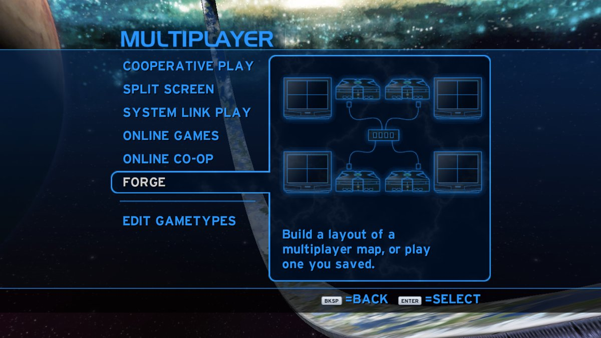

2. The Forge lobby lists the multiplayer maps you have, then the campaign missions you have. Pick one with up and down, then A (or right) to go to its rows:
   - on FORGE: NEW LAYOUT, or one of the map's saved layouts to carry on with it;
   - on PLAY: GAME TYPE (left and right: slayer, team slayer, capture the flag, king of the hill, oddball, race), then a layout to play.

   LB and RB (Q and E on the keyboard) switch between FORGE and PLAY. Y (Tab) on a layout deletes it; press it twice. B (Esc) goes back.

   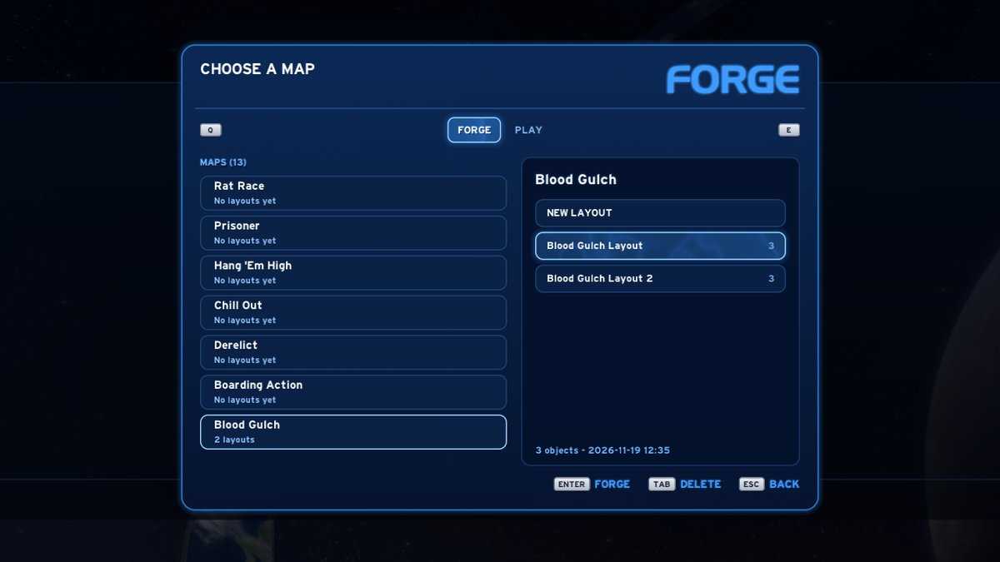

   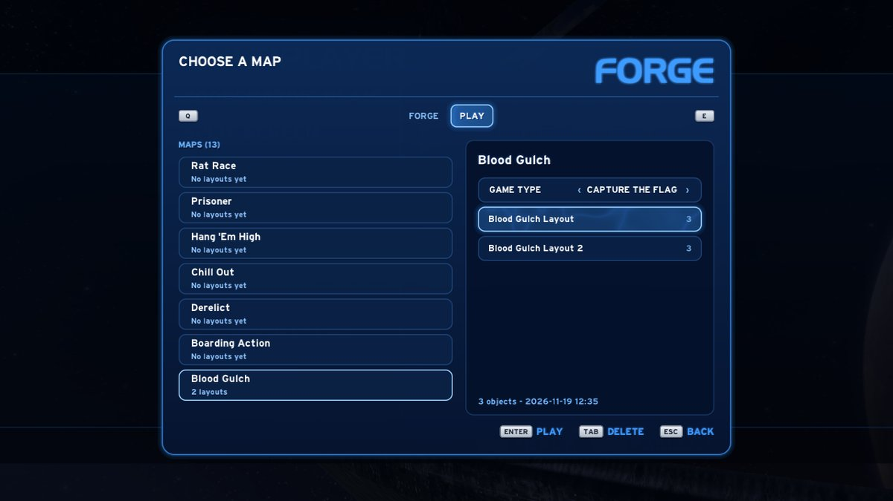

## Building

You start as the monitor. The prompts at the bottom of the screen say what the buttons do right now. They show your controller's buttons (`input.button_style`, and `input.hud_buttons = "hd"` for the HD buttons) or, after you use the keyboard, its keys.

| Controller | Keyboard and mouse | Does |
|---|---|---|
| Left stick | Movement keys | Fly |
| Right stick | Mouse | Look |
| A / left stick click | Space / Left Ctrl, C | Fly up / down |
| Left trigger (nothing held) | Left Shift | Fly faster |
| Right trigger | Left mouse button | Grab what the crosshair is on, or let go of what you hold |
| Left trigger held (holding) | Right mouse button held | Rotate mode: the right stick (the mouse) turns it; with the right trigger held too, it rolls. The left stick pushes it away and pulls it in |
| — | Wheel | Push away / pull in what you hold |
| Right stick click (rotate mode) | N | Nudge mode: small steps instead |
| B | F | Copy what you hold or aim at |
| Y | Delete, X | Delete what you hold or aim at (held for half a second instead, with a bar that fills over the crosshair, when OPTIONS > DELETE is HOLD) |
| RB (Black) | U | Set it upright |
| LB (White) | Q | Flying speed; in rotate mode, the rotation snap (off, 15, 45, 90 degrees) |
| X | E | The Forge menu; on an object or marker of your layout, its PROPERTIES |
| Back + right stick click | M | Switch between the monitor and playing as the Spartan |

Spawn points, teleporters and game type objects show as markers on the ground only while you're the monitor. Players don't see them, as a map's own teleporters have no marker: place a Teleporter or Teleporter Base from SCENERY where you want players to see one.

The keyboard's keys are `controls.forge_*` in `config.toml` (see [settings.md](settings.md)). The Forge menu's OPTIONS > CONTROLS lists them as they are set.

## The Forge menu

X (E) opens the Forge menu: a narrow panel at the right of the screen, so the map stays in view. Its title and the budget are at the top, then the tabs, the list, a box about the row chosen, and the prompts at its foot. It works like the Delta Guide: LB and RB (Q and E) change the tab, the d-pad (arrows or WASD) moves, A (Enter) chooses, B (Esc) goes back, and the mouse can click rows and prompts. X closes it.

- OBJECT BROWSER: the categories (VEHICLES, WEAPONS, EQUIPMENT, SCENERY, AI, TELEPORTERS, OBJECTIVES, SPAWNING, AI ROUTES, VOLUMES, EFFECTS, DECALS) with how many objects each has. A opens a category, and A on an object places it in your hands. The count at the top right is the budget: 512 objects and markers (`game.forge_objects`, 64 to 512; 256 before).

  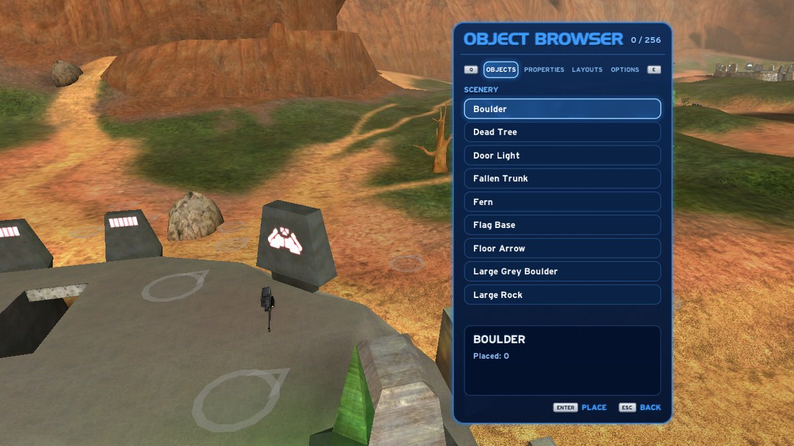

- PROPERTIES: what you hold, if you placed it, or with nothing held what the crosshair is on when you press X (an object or marker of your layout; the map's own objects open OBJECTS). It opens here then. Left and right change a value: team, respawn time, placed at start, yaw, pitch and roll, reset rotation, and physics (normal, fixed: never moves, phased: no collision, shots pass through). An AI character has its AI TEAM, AI (on or off), RESPAWN (never, or 10, 30, 60 or 120 seconds after it dies), placed at start and yaw. A spawn point has its team, game type, kind and facing; a teleporter its channel; a game type object its index (a CTF flag's team, a hill's number).

  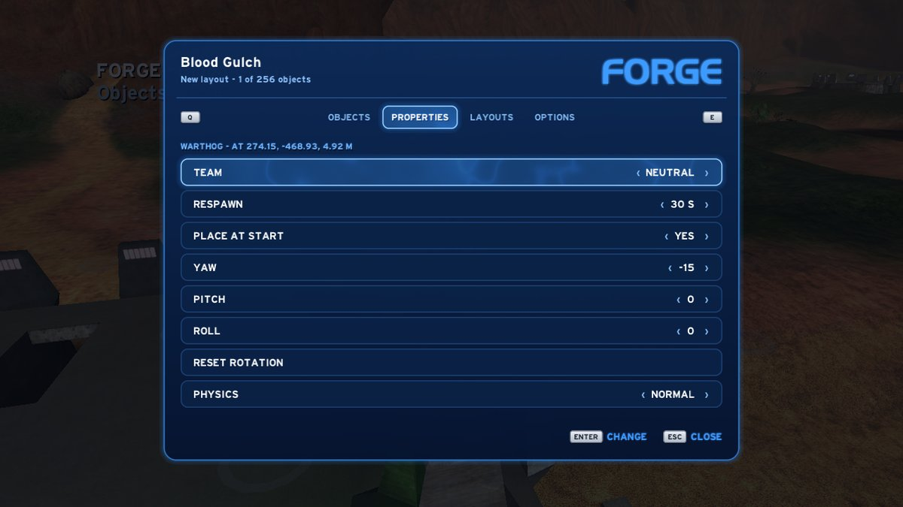

- LAYOUTS: SAVE saves the layout under its title ("Blood Gulch Layout" for a new one). SAVE AS NEW saves a copy under a new title ("Blood Gulch Layout 2"). Below them are the map's saved layouts: A loads one in place of this one (press it twice, since what isn't saved is lost), Y deletes one (twice). CURRENT marks the one you're editing. To rename a layout, use the console: `forge save <title>`.

  

- SKY AND FOG: the layout's sky and fog (below).

- OPTIONS: SNAP (a grid, and turns in steps), MOVE SPEED, ROTATION SNAP, DELETE (PRESS deletes at a press, the default; HOLD: CONTROLLER deletes when Y is held half a second, the keyboard's key still at a press; HOLD: ALL holds both; `game.forge_hold_to_delete`), GRAB RANGE (how far the crosshair reaches to grab, copy or delete: NEAR 20 world units (about 60 m), MEDIUM 35 world units (about 105 m), FAR 60 world units (about 180 m), the default; `game.forge_grab_range`), HELD FACING (KEEP: what you hold keeps the facing you grabbed it with, the default; FOLLOW VIEW: it turns with the camera, so it keeps facing the same way from you, until you turn it by hand; `game.forge_held_facing`), UNDO and REDO, NEW ROUND (the map starts over with the layout placed again), CLEAR DEAD AI, CLEAR ALL AI (press it twice), PLAY AS SPARTAN and CONTROLS.

  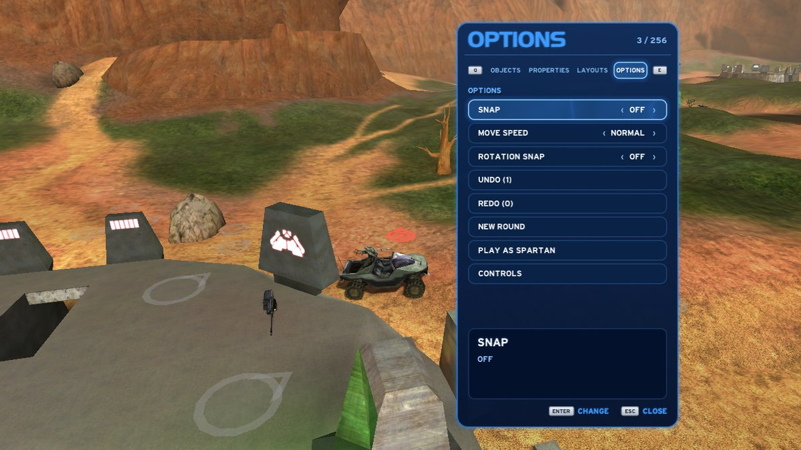

The map's own objects (its vehicles, weapons, scenery and the rest) can be moved and deleted too, and the layout keeps that. One you delete is gone when the layout is loaded or played. One you grab or turn becomes one of the layout's objects: it counts in the budget, its properties can be set, and it is placed where you let it go. The map's file is never changed: the layout lists which of the map's objects it takes away.

## Sky and fog

SKY AND FOG, a tab of its own in the Forge menu, sets how the layout's outdoors looks, saved with the layout (left and right, or A, step a row):

- SKY: MAP'S, or another sky the map has. The stock multiplayer maps have one sky each, so this only changes something on maps that carry more than one.
- FOG: MAP'S or CUSTOM. FOG COLOR (grey, white, blue, teal, green, sand, orange, red, purple, black), FOG DENSITY (10 to 100 percent), FOG START and FOG END (where the fog begins and where it reaches its density) set the custom fog. Changing any of them turns the custom fog on.

The custom fog replaces the map's outdoor fog. Indoors, and the map's own fog planes, stay as they are. Every player of the Forge game, or of the layout played, sees the same sky and fog. Nothing of the map file changes, and other games draw the map's own.

## Volumes

VOLUMES places zones that act on whoever is in them:

- KILL VOLUME: kills a unit at once, the way the game kills a unit that falls out of the world.
- DAMAGE VOLUME: takes a share of full health a second (5, 10, 25, 50 or 100 percent), shields first, then health.
- GRAVITY VOLUME: scales gravity (0, 25, 50, 75, 150 or 200 percent) for what is in the air inside it: a jump, a falling vehicle, a dropped weapon.

A volume is a box (width, length and height, from its floor up) or a sphere (its radius, resting on its floor), turned by its yaw. TARGET picks what it acts on: everyone (every unit, AI too), players, red players or blue players. Its PROPERTIES rows are TARGET, TYPE, the amount, YAW, SHAPE, WIDTH (a sphere's RADIUS), LENGTH and HEIGHT. A layout holds up to 32 volumes, within the markers' budget.

Only the monitor sees volumes: each is drawn as a wireframe in its type's color (kill red, damage orange, gravity blue) with its marker on the floor, where the crosshair grabs it. The Spartan and anyone playing the layout see nothing. They act the same in a Forge game (as the Spartan) and in a layout played, a game tick at a time, from the layout alone. The monitor's own hidden body is left alone.

## Effects and decals

EFFECTS lists the loaded map's effects (smoke, sparks, explosions, a Banshee's glow...) and DECALS its decals (scorch marks, blood, Forerunner symbols...). On a multiplayer map, the effects and decals of what Forge brings in from the campaign maps (AI characters, campaign vehicles and objects) are listed too, but only those of a mission the layout already has a character, vehicle or object from, so a saved layout never names an effect that isn't there when it's played without them. A choice is placed like a marker: carried, let go, turned, deleted, its PROPERTIES opened from it.

- An effect plays where it stands. REPEAT is LOOP (it starts again as soon as it ends) or a number of seconds between starts (1 to 60). Placed effects never hurt anyone: an explosion's effect shows and sounds, and deals no damage.
- A decal is laid on the ground under it. SIZE scales it (30 to 400 percent).

Everyone sees them, in a Forge game and in a layout played; the monitor also sees a small marker where each stands. A layout holds up to 16 effects and 32 decals, within the markers' budget, so what they cost stays small. One effect plays at a time per marker. A layout made on one map names its effects and decals by path; a layout's effect that another copy of the map lacks is skipped.

A layout's spawn points replace the map's own for the players they fit (the game type, the team). A game type object replaces the map's own of that type (a CTF flag: that team's). Any type the layout has none of keeps the map's.

## AI characters

A multiplayer map has no AI characters in its files. Forge brings them in from your own campaign maps, and a campaign mission has its own.

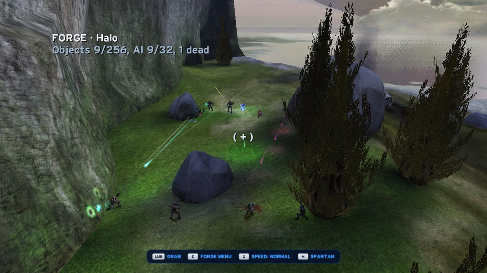

- **On a multiplayer map.** As a Forge game (or a layout played) of a multiplayer map starts, Forge reads the characters from the campaign maps in your maps folder: the Covenant from The Silent Cartographer (or Truth and Reconciliation, Assault on the Control Room, Keyes), the Marines from Halo (or Assault on the Control Room, The Silent Cartographer), the Flood and the Sentinels from The Library (or Keyes, 343 Guilty Spark, The Maw). Nothing is copied off your machine and nothing is kept: it takes a couple of seconds each time, and the pixels and sounds go in a file in the cache folder that is deleted when the map ends. A faction with none of its maps there isn't offered: the AI category says which are missing. Only the Xbox's map files are read.

  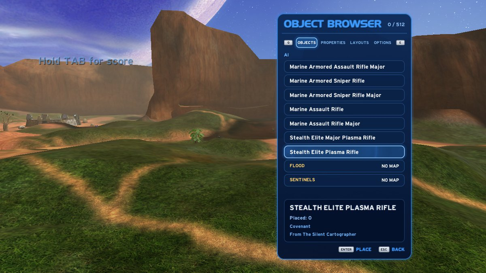
- **Campaign vehicles and objects.** On a multiplayer map, the same reading brings the CAMPAIGN VEHICLES category (the Banshee, the Wraith, the Shade, the campaign's Ghost and Scorpion, the Pelican and the Covenant dropship, from Assault on the Control Room and The Silent Cartographer) and the CAMPAIGN OBJECTS category (Covenant crates, shield generators and uplinks, Forerunner lights, holo displays and doors, crashed Pelicans and dropships, metal barricades, trees, from 343 Guilty Spark and The Silent Cartographer). Each item's box says its group and the mission it came from, and a group whose maps are missing is listed as such. The vehicles drive and fire as in the campaign (the Wraith's driver's seat takes the Scorpion driver's animations, since a player's unit has none of an Elite's). In a Forge game the Pelican and the dropship can be flown: walk up to the Pelican's nose or the dropship's front left pod and press action (hold it to get out). Throttle with the stick, steer with the aim, jump to climb and crouch to come down; with neither, the craft holds its height. Up to ten players ride the Pelican and eight the dropship's pods. The dropship flies unarmed: its gun is its AI gunner's, which isn't brought in.

  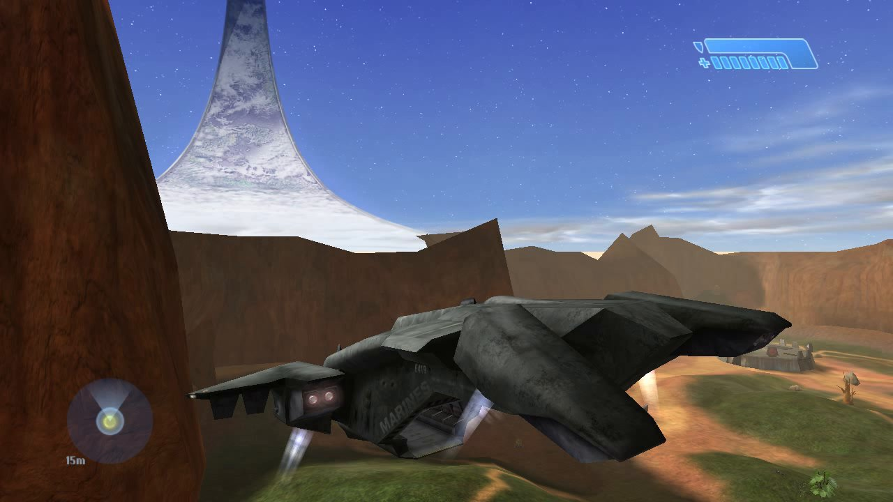

  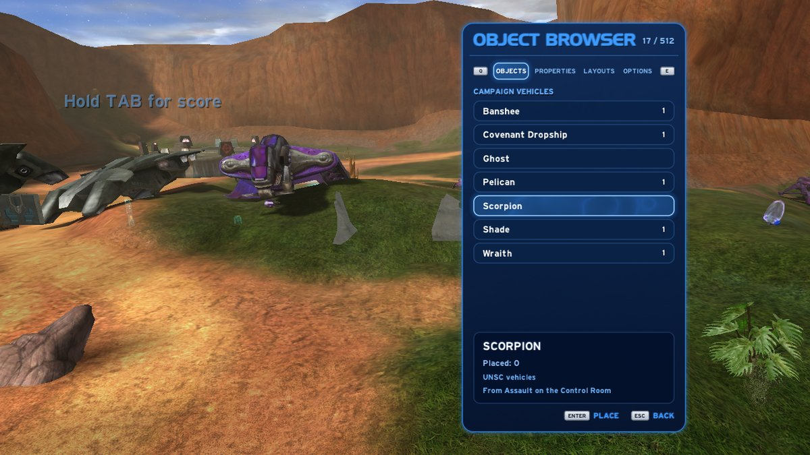

- **On a campaign mission.** The missions are in the Forge lobby after the multiplayer maps.
- **The mission stays out.** A Forge game, or a layout played, on a campaign mission is the same local game as on a multiplayer map. The mission's scripts don't run and its encounters aren't created, so there is no cinematic and none of its own characters. You start at the mission's own starting point unless the layout has spawn points, with the part of the level it's in loaded (Assault on the Control Room and Two Betrayals don't start in their first part). The mission's scripts are what switch between a level's parts as you go, so the part loaded stays the start's: flying or walking into another part of the level shows nothing there. There is no announcer (a mission has none).
- **What a character is.** The AI category lists the mission's actor variants that have a body: grunts, jackals, elites, hunters, marines, the Flood and so on, each with the weapon the mission gives it (`Elite Major Plasma Rifle`). A vehicle's crew (a dropship's gunner) is not offered. A placed character gets its variant's weapon, grenades and camouflage and fights as the mission's own do.
- **AI TEAM.** DEFAULT is the character's own side. PLAYER, HUMAN, COVENANT, FLOOD and SENTINEL put it on that side. Marines are on your side, as in the campaign.
- **AI.** OFF makes it stand where you put it, facing the way you turned it. It can still be shot.
- **RESPAWN.** NEVER, or the time after its death before it comes back where you put it.
- **The counts.** The HUD shows `AI 6/128, 3 dead`. At most 128 characters are alive at once (`game.forge_ai`, 8 to 128). Past that, a character that should come back (a respawn, a new round, a layout loaded) waits until one alive dies, and the HUD says how many wait. A dead character doesn't count against the budget, but it stays in the layout: the next round brings it back and a save keeps it. Its body goes after 45 seconds, or sooner when more than 32 bodies lie around.
- **Clearing.** OPTIONS > CLEAR DEAD AI takes the dead characters out of the layout. CLEAR ALL AI takes every character out (press it twice). Neither can be undone.

  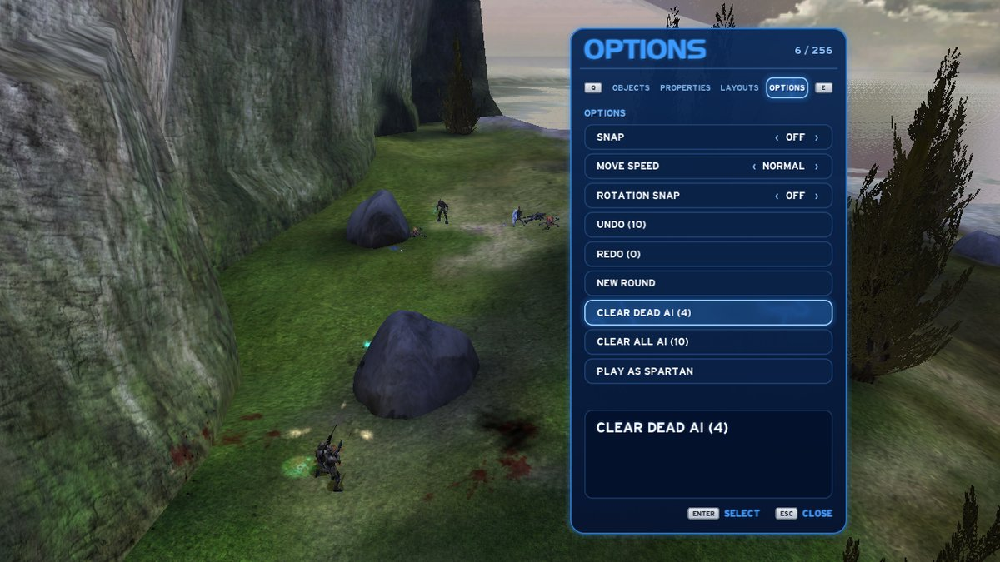

AI characters are saved in the layout with their AI team, AI and respawn (layout versions 2 and 3, which were already part of the format), and their BEHAVIOR, ROUTE and VEHICLES, the routes' points and areas, and a vehicle's AI ROUTE (version 12). A layout's characters are placed when the map has them or Forge brought them in. Any other is skipped, and the log says so.

## AI movement

A character placed holds where you put it and fights from there, as before. Its PROPERTIES can send it moving instead. Characters find their way with the map's AI navigation (the multiplayer bots' knowledge of a map, as its own module): the walkable ground with its ramps, and the jumps and drops between areas the ground alone doesn't join. The engine's own path search and actor movement do the walking, so they steer, avoid each other and take cover as they do in the campaign.

- **BEHAVIOR.** HOLD (the default) stays put. PATROL walks its ROUTE: the route's AI GO HERE points in the order you placed them, round and round, stopping where a point says; with only a PATROL AREA on the route, it walks to spots inside the area. With no route it wanders near where you put it. It leaves its route or area to fight an enemy it knows of nearby, then goes back. PURSUE goes after the nearest enemy it has seen or heard, anywhere on the map; with none known, it heads for the nearest enemy (a search). With no enemy left it walks back to where you put it.
- **ROUTE.** NONE or 1 to 16.
- **VEHICLES.** ON: the character boards a free vehicle within 30 world units (the AI's own vehicle entering, as the campaign's scripts send characters to vehicles) and drives it to its goals, or takes its gunner's seat when it already has a driver. A vehicle whose tag has the AI's driving (the Ghost) is driven by the engine's own AI driving. The engine has no AI driving for the Warthog (the campaign drives it on recorded paths), so a character drives a vehicle like that as the bots do: along the way the path search finds, facing its next step with the throttle on. A character only takes a seat its body has animations for.
- **AI ROUTES category.** AI GO HERE is a route's point. Its properties: ROUTE (1 to 16), STOP (NONE, WAIT 5 S, WAIT 15 S, LAND) and its yaw. PATROL AREA is a circle a route's characters patrol inside, with SIZE (3 to 20 world units). The monitor sees each route as a line joining its points, last to first, and each area as a ring.
- **A flown route.** Give a Pelican or Covenant dropship an AI ROUTE and it flies itself: it lifts off, flies to each point of the route at a height over it, sets down at a point whose STOP is LAND, lets its riders out, and goes on. Characters with VEHICLES on standing within 16 world units of it when it is placed or the round starts are its riders, in the seats their bodies have animations for (Marines in the Pelican; the Covenant have no animations for the riders' seats, which are set up for players). It is flown as the campaign flies its dropships on recorded paths: the craft's own controls set each tick, its own flight physics doing the flying. A player who takes the pilot's seat takes over.

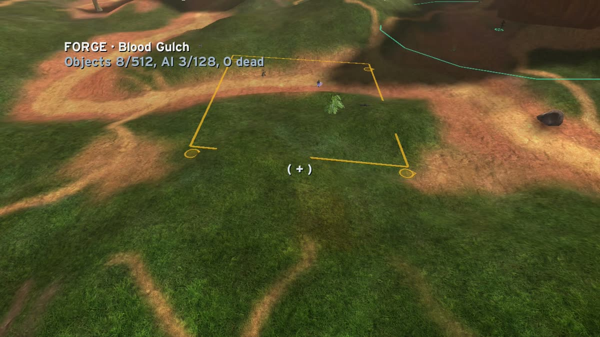

What doesn't work yet: a character boards a Banshee but doesn't take off in it. Characters don't take teleporters (the game sends only players through them) or climb ladders. On Hang 'Em High a character going from the ground floor up to the walkways stops below them. Movement is local, as Forge is: nothing of it is sent over the network.

## From the console

- `forge start bloodgulch` starts a Forge game of Blood Gulch (any of the Xbox multiplayer maps or the campaign missions, by its short name: `beavercreek`, `hangemhigh`, `longest`, `a30`, `b30`...).
- `forge start bloodgulch my_layout` starts it with a saved layout placed.
- `forge play bloodgulch my_layout ctf` plays a saved layout as `slayer` (the default), `teamslayer`, `ctf`, `king`, `oddball` or `race`.
- `forge layouts` lists the saved layouts (a damaged one is listed as such, never read).

## Layout files

Layouts are saved in `forge/<map>/<name>.hmv` in the save root. The name is made from the title: lower-case letters, digits and `_`, with a number when another layout has it. Names Windows keeps for devices (`con`, `prn`, `aux`, `nul`, `com1` to `com9`, `lpt1` to `lpt9`) are never used: a layout titled `CON` is saved as `con_1.hmv`, and a file or map folder with one of those names is never opened. The format is small and fixed, so layouts can be shared as files:

- a 64-byte header: `HFRG`, version, header size, flags, the map's short name, the map's checksum, the counts, the payload's size and its CRC-32;
- the tag paths the records place (never tag indices);
- 48-byte records: kind, path index, team, position, yaw, pitch and roll, respawn time, game types, flags;
- the map's own objects the layout takes away (version 11): each by its category and its index in the map's list;
- the title, author, description and date, as UTF-8.

All little-endian. Versions 1 to 7 and 11 to 16 are read. Each version adds what a layout may hold (AI settings, spawn points, teleporters, game type objects, physics, the map's own objects taken away, AI movement; version 13: more than 256 records, up to 512; version 14: volumes; version 15: the sky and fog; version 16: effects and decals), and a layout is written as the lowest version that holds it, so a layout without the newer things stays readable by older builds, and a build from before the bigger budget reads a layout of more than 256 as one from a newer build. Versions 8 to 10 are kept for the layouts of the Vita build (game modes, boundaries, a lobby camera) and aren't read here; version 11 is the number the Halo CE Vita build uses for the same list of the map's own objects. `port/linux/game/forge_files.h` describes every byte.

Every file goes through the validator before anything is read from it, whether you made it or it came from somewhere else. It checks the size, the header, the version, the map, the counts against the limits, the payload size and CRC-32, every path (characters, length, groups Forge places), every record (kind, path index, every field in range, finite floats inside the world, no unknown flags) and the texts (terminated UTF-8). A file that fails any check is refused whole and the log says why. When a layout is placed, a record whose tag the map doesn't have is skipped, and the budget and the map's bounds are checked again. `tools/test_forge_files.py` tests the validator against malformed files, and fuzzes it.

## Console commands

Besides `start`, `play` and `layouts`: `forge` (switch monitor and Spartan), `forge save <title>`, `forge spawn <name>`, `forge marker respawn|initial|sender|receiver|flag|hill|oddball|race|route|area|kill|damage|gravity`, `forge effect <name>`, `forge decal <name>`, `forge grab [#id]`, `forge drop`, `forge delete [#id]`, `forge turn <degrees>`, `forge property <name> [-]`, `forge distance <world units>`, `forge environment sky|fog|color|density|start|end [-]`, `forge nudge <direction>`, `forge snap [on|off]`, `forge undo`, `forge redo`, `forge deleteall <category>`, `forge clearai dead|all`, `forge round`, `forge camera x y z yaw pitch`, `forge list [category]`, and `forge where`, `budget`, `objects`, `spawns`, `netflags`, `map [category]` (the map's own objects, and the ones the layout takes away), `ai` (and `ai move`, the characters' movement and the flown routes) to log the state. The tests' controller: `forge press`, `forge stick`, `forge look`, `forge menu open|close`, `forge shot`, `forge kill #id` (an AI character).
