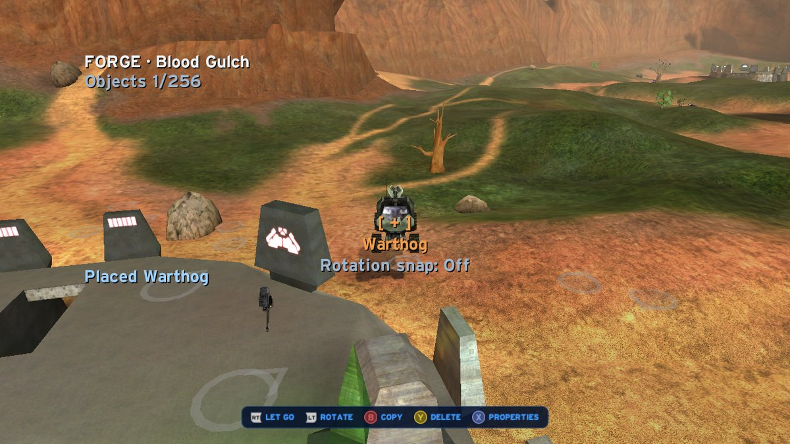
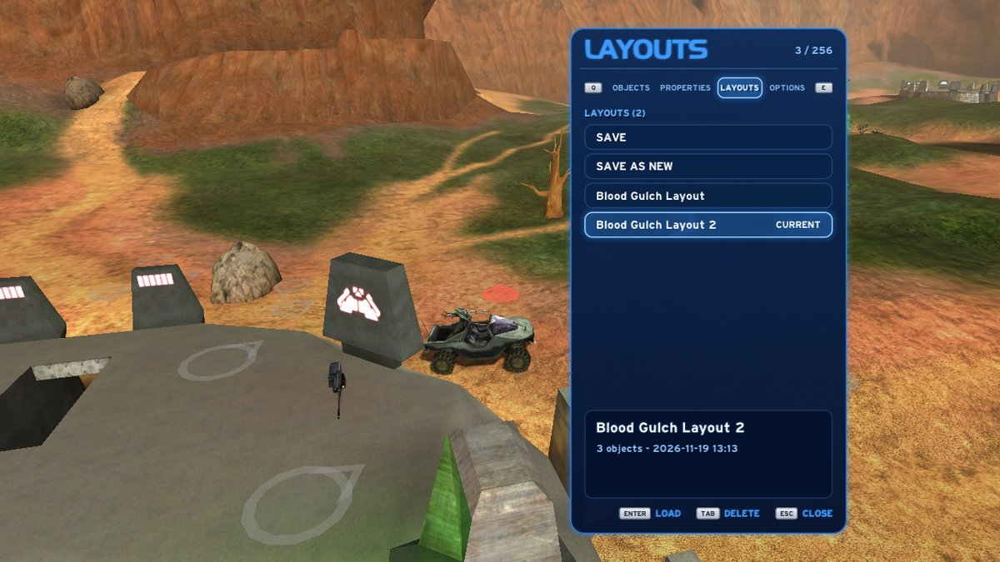

# Forge

Forge is a layout editor for the multiplayer maps. You fly the map as a monitor, place, move, turn and delete objects, put down your own spawn points, teleporters and game type objects (CTF flags, hill points, oddball spawns, race checkpoints), and save the result as a layout. A saved layout can then be played as a normal game of any game type.

It's off by default. Turn it on with FORGE in the Delta Guide's SETTINGS, or `game.forge = true` in `config.toml` (`HALO_FORGE=1`). The Multiplayer menu shows FORGE the next time the menus load. Forge is local only: a Forge game is a game you play alone, and a layout is played as a local game. Nothing of it is sent over the network.

## Starting from the menus

1. Main menu > MULTIPLAYER > FORGE. FORGE is in the Chupathingy menus (`display.menus = "chupathingy"`, the default); the Xbox menus stay as the Xbox has them.

   

2. The Forge lobby lists the multiplayer maps you have. Pick one with up and down, then A (or right) to go to its rows:
   - on FORGE: NEW LAYOUT, or one of the map's saved layouts to carry on with it;
   - on PLAY: GAME TYPE (left and right: slayer, team slayer, capture the flag, king of the hill, oddball, race), then a layout to play.

   LB and RB (Q and E on the keyboard) switch between FORGE and PLAY. Y (Tab) on a layout deletes it; press it twice. B (Esc) goes back.

   

   

## Building

You start as the monitor. The prompts at the bottom of the screen say what the buttons do right now. They show your controller's buttons (`input.button_style`, and `input.hud_buttons = "hd"` for the HD buttons) or, after you use the keyboard, its keys.

| Controller | Keyboard and mouse | Does |
|---|---|---|
| Left stick | Movement keys | Fly |
| Right stick | Mouse | Look |
| A / left stick click | Space / Left Ctrl, C | Fly up / down |
| Left trigger (nothing held) | Left Shift | Fly faster |
| Right trigger | Left mouse button | Grab what the crosshair is on, or let go of what you hold |
| Left trigger held (holding) | Right mouse button held | Rotate mode: the right stick (the mouse) turns it; with the right trigger held too, it rolls. The left stick pushes it away and pulls it in |
| — | Wheel | Push away / pull in what you hold |
| Right stick click (rotate mode) | N | Nudge mode: small steps instead |
| B | F | Copy what you hold or aim at |
| Y | Delete, X | Delete what you hold or aim at |
| RB (Black) | U | Set it upright |
| LB (White) | Q | Flying speed; in rotate mode, the rotation snap (off, 15, 45, 90 degrees) |
| X | E | The Forge menu |
| Back + right stick click | M | Switch between the monitor and playing as the Spartan |

Spawn points, teleporters and game type objects show as markers on the ground only while you're the monitor. Players don't see them, as a map's own teleporters have no marker: place a Teleporter or Teleporter Base from SCENERY where you want players to see one.

The keyboard's keys are `controls.forge_*` in `config.toml` (see [settings.md](settings.md)). The Forge menu's OPTIONS > CONTROLS lists them as they are set.

## The Forge menu

X (E) opens the Forge menu: a narrow panel at the right of the screen, so the map stays in view. Its title and the budget are at the top, then the tabs, the list, a box about the row chosen, and the prompts at its foot. It works like the Delta Guide: LB and RB (Q and E) change the tab, the d-pad (arrows or WASD) moves, A (Enter) chooses, B (Esc) goes back, and the mouse can click rows and prompts. X closes it.

- OBJECT BROWSER: the categories (VEHICLES, WEAPONS, EQUIPMENT, SCENERY, TELEPORTERS, OBJECTIVES, SPAWNING) with how many objects each has. A opens a category, and A on an object places it in your hands. The count at the top right is the budget: 256 objects and markers.

  

- PROPERTIES: what you hold, if you placed it. It opens here when you hold something. Left and right change a value: team, respawn time, placed at start, yaw, pitch and roll, reset rotation, and physics (normal, fixed: never moves, phased: no collision, shots pass through). A spawn point has its team, game type, kind and facing; a teleporter its channel; a game type object its index (a CTF flag's team, a hill's number).

  

- LAYOUTS: SAVE saves the layout under its title ("Blood Gulch Layout" for a new one). SAVE AS NEW saves a copy under a new title ("Blood Gulch Layout 2"). Below them are the map's saved layouts: A loads one in place of this one (press it twice, since what isn't saved is lost), Y deletes one (twice). CURRENT marks the one you're editing. To rename a layout, use the console: `forge save <title>`.

  

- OPTIONS: SNAP (a grid, and turns in steps), MOVE SPEED, ROTATION SNAP, UNDO and REDO, NEW ROUND (the map starts over with the layout placed again), PLAY AS SPARTAN and CONTROLS.

  

The map's own objects (its vehicles, weapons, scenery and the rest) can be moved and deleted too, and the layout keeps that. One you delete is gone when the layout is loaded or played. One you grab or turn becomes one of the layout's objects: it counts in the budget, its properties can be set, and it is placed where you let it go. The map's file is never changed: the layout lists which of the map's objects it takes away.

A layout's spawn points replace the map's own for the players they fit (the game type, the team). A game type object replaces the map's own of that type (a CTF flag: that team's). Any type the layout has none of keeps the map's.

## From the console

- `forge start bloodgulch` starts a Forge game of Blood Gulch (any of the Xbox multiplayer maps, by its short name: `beavercreek`, `hangemhigh`, `longest`...).
- `forge start bloodgulch my_layout` starts it with a saved layout placed.
- `forge play bloodgulch my_layout ctf` plays a saved layout as `slayer` (the default), `teamslayer`, `ctf`, `king`, `oddball` or `race`.
- `forge layouts` lists the saved layouts (a damaged one is listed as such, never read).

## Layout files

Layouts are saved in `forge/<map>/<name>.hmv` in the save root. The name is made from the title: lower-case letters, digits and `_`, with a number when another layout has it. Names Windows keeps for devices (`con`, `prn`, `aux`, `nul`, `com1` to `com9`, `lpt1` to `lpt9`) are never used: a layout titled `CON` is saved as `con_1.hmv`, and a file or map folder with one of those names is never opened. The format is small and fixed, so layouts can be shared as files:

- a 64-byte header: `HFRG`, version, header size, flags, the map's short name, the map's checksum, the counts, the payload's size and its CRC-32;
- the tag paths the records place (never tag indices);
- 48-byte records: kind, path index, team, position, yaw, pitch and roll, respawn time, game types, flags;
- the map's own objects the layout takes away (version 11): each by its category and its index in the map's list;
- the title, author, description and date, as UTF-8.

All little-endian. Versions 1 to 7 and 11 are read. Each version adds what a layout may hold (AI settings, spawn points, teleporters, game type objects, physics, the map's own objects taken away), and a layout is written as the lowest version that holds it. Version 11 is the number the Halo CE Vita build uses for the same list. `port/linux/game/forge_files.h` describes every byte.

Every file goes through the validator before anything is read from it, whether you made it or it came from somewhere else. It checks the size, the header, the version, the map, the counts against the limits, the payload size and CRC-32, every path (characters, length, groups Forge places), every record (kind, path index, every field in range, finite floats inside the world, no unknown flags) and the texts (terminated UTF-8). A file that fails any check is refused whole and the log says why. When a layout is placed, a record whose tag the map doesn't have is skipped, and the budget and the map's bounds are checked again. `tools/test_forge_files.py` tests the validator against malformed files, and fuzzes it.

## Console commands

Besides `start`, `play` and `layouts`: `forge` (switch monitor and Spartan), `forge save <title>`, `forge spawn <name>`, `forge marker respawn|initial|sender|receiver|flag|hill|oddball|race`, `forge grab [#id]`, `forge drop`, `forge delete [#id]`, `forge turn <degrees>`, `forge property <name> [-]`, `forge distance <world units>`, `forge nudge <direction>`, `forge snap [on|off]`, `forge undo`, `forge redo`, `forge deleteall <category>`, `forge round`, `forge camera x y z yaw pitch`, `forge list [category]`, and `forge where`, `budget`, `objects`, `spawns`, `netflags`, `map [category]` (the map's own objects, and the ones the layout takes away) to log the state. The tests' controller: `forge press`, `forge stick`, `forge look`, `forge menu open|close`, `forge shot`.
