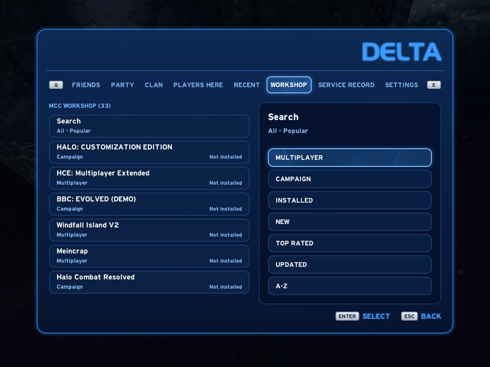

# MCC Workshop

Chupathingy can play Halo CE maps from the Steam Workshop of
Halo: The Master Chief Collection (MCC). You need to own MCC on Steam. The
files come from your own Steam account and stay in your own folders. The
game reads them where they are and never copies them.

Open the Delta Guide and go to **Workshop**.

The list is Steam's own public Workshop list of MCC's Halo CE items. It
works before anything is set up. Only Halo CE items are listed: MCC's
Workshop also has items for its other games, and those never show.

## Setting up

While something is missing, rows at the top of the list say what to do
next. Each row shows **Ready**, **To do**, **Working** or **Not available**,
and has one button.

### Windows, and Linux with MCC in Steam

1. **Steam**: install Steam and sign in.
2. **MCC**: own Halo: The Master Chief Collection. **STORE** opens its page.
3. **Halo CE files**: in Steam, open MCC's **Properties**, then **DLC**, and
   tick **Halo: Combat Evolved Anniversary**. Multiplayer is enough.
   **OPEN STEAM** takes you there.

To let the Workshop tab install items itself, choose **USE STEAM** on an
item's page and confirm. Steam then shows MCC as running while the Workshop
tab is open, and only then. Without it, **GET** opens the item's page in
Steam and you subscribe there.

### Mac, Linux, and Windows without MCC in Steam

The game downloads Workshop items itself, straight from Steam, with no Steam
client and no steamcmd.

1. **Steam account**: in the Guide's **Settings**, choose **STEAM ACCOUNT**.
   A QR code shows. Open the Steam app on your phone, go to **Steam Guard**,
   scan it and approve. The game never sees your password. It keeps the
   sign-in in the macOS Keychain (Windows: a file sealed to your Windows
   account; Linux: your desktop's keyring, else a private file in the data
   folder, which is not encrypted: Settings tells you when that is where it
   is). Choose **STEAM ACCOUNT** again and confirm to unlink: the game
   forgets the sign-in and tells Steam to revoke it.
2. **MCC**: own Halo: The Master Chief Collection on Steam.

Your running Steam app stays signed in while the game downloads.

Only **GET** and **UPDATE** need the Steam account; they say **LINK STEAM**
until it is linked. Items already downloaded never need it: after you
unlink, with Steam closed and no internet, they still show under
**Installed** and in the map lists, and they load, host and join as before.

## Getting items

Pick an item and press **GET**. It shows **Downloading** with its progress,
then **Installed**, and its maps join the map lists. An installed item
offers **PLAY**, **UPDATE** when Steam has a newer version, and **REMOVE**.
The list is Steam's, a page at a time: **More items** at the end of a page
shows the next.

The **Search** row filters the list by Steam's tags (**Multiplayer**,
**Campaign**) or **Installed**, and sorts it **Popular**, **New**,
**Top rated**, **Updated** or **A-Z**. Only the filters that some item has
are offered.

## Joining a game with a Workshop map

When you join a game whose MCC map you don't have, the game first asks
Steam about the item. Only an MCC Halo CE item is offered, under Steam's
own name for it and its size, never the name the host gives. Say yes and
it downloads, then you join again. Nothing is downloaded unless you say
yes, or you ticked **Don't ask again** with yes before
(`network.workshop_downloads = "always"`). Even then, an item over 1 GB asks
first (`network.workshop_downloads_limit_mb`). After the download, an item
whose own files don't say Halo CE is not loaded.

The game's own download refuses an item over 8 GB, a file over 4 GB, and an
item the disk has no room for (`game.workshop_item_limit_mb`,
`game.workshop_file_limit_mb`).

## Where the files are

- With the Steam client: Steam's own Workshop folder,
  `steamapps/workshop/content/976730/<item>` in the Steam library that has
  MCC.
- Downloaded by the game: the `steam` folder inside the game's data folder,
  `steam/steamapps/workshop/content/976730/<item>`, the same layout as
  Steam's. Set `paths.steam_downloads` in `config.toml` (Settings shows it
  as **WORKSHOP FOLDER**) to put it on another drive. A download in
  progress sits in `steam/steamapps/workshop/downloads/976730/<item>` and
  moves into place when every file is checked.

**REMOVE** deletes the game's own copy, never anything in Steam's folders.

## What the game sends

The list and item details come from Steam's public Workshop pages, without
a Steam key or sign-in. Item pictures come from Steam's picture server, only
for the item you look at, and are kept in the cache folder. Nothing about
you is sent with them.

A download talks to Steam only: it signs in with your linked account and
fetches the item from Steam's content servers. Your Steam name is shown in
Settings on this computer and is never sent to Delta, game servers, logs or
crash reports. Online Games shows an MCC game's map picture from our site's
copy of it, else from Steam's picture server, before you download the map.
