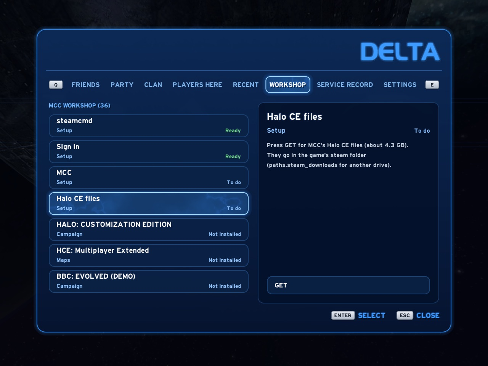
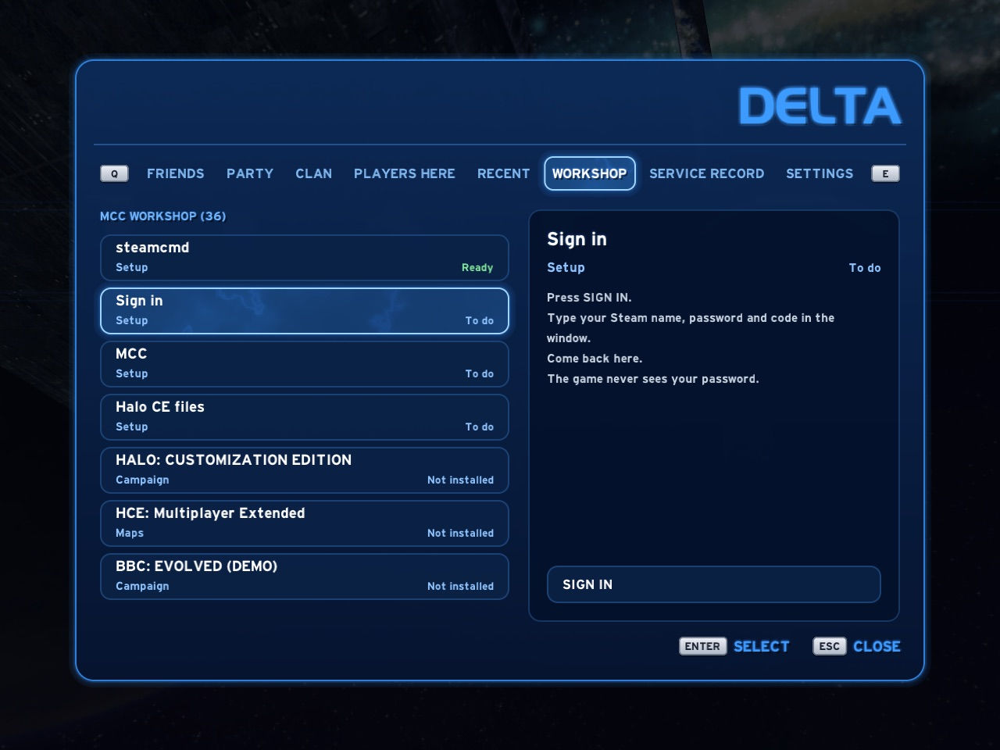

# MCC Workshop

Chupathingy can play Halo CE maps from the Steam Workshop of
Halo: The Master Chief Collection (MCC). You need to own MCC on Steam. The
files come from your own Steam account and stay in your own folders. The
game reads them where they are and never copies them.

Open the Delta Guide and go to **Workshop**.

The list is Steam's own public Workshop list of MCC's Halo CE items. It
works before anything is set up. Only Halo CE items are listed: MCC's
Workshop also has items for its other games, and those never show.

## Setting up

While something is missing, rows at the top of the list say what to do
next. Each row shows **Ready**, **To do**, **Working** or **Not available**,
and has one button.

### Windows, and Linux with MCC in Steam

1. **Steam**: install Steam and sign in.
2. **MCC**: own Halo: The Master Chief Collection. **STORE** opens its page.
3. **Halo CE files**: in Steam, open MCC's **Properties**, then **DLC**, and
   tick **Halo: Combat Evolved Anniversary**. Multiplayer is enough.
   **OPEN STEAM** takes you there.

To let the Workshop tab install items itself, choose **USE STEAM** on an
item's page and confirm. Steam then shows MCC as running while the Workshop
tab is open, and only then. Without it, **GET** opens the item's page in
Steam and you subscribe there.

### Mac, and Linux without the Steam client

MCC has no Mac version, so the game uses steamcmd, Valve's command-line Steam
tool, to download the Windows files it needs.

1. **steamcmd**: on a Mac, open Terminal and run
   `brew install --cask steamcmd`. **COPY** puts that line on the clipboard.
   On Linux, install steamcmd from your distribution.
2. **Sign in**: press **SIGN IN**. A Terminal window opens. Type your Steam
   name, password and Steam Guard code there, then come back. steamcmd keeps
   the sign-in. The game never sees your password.

   

3. **MCC**: own Halo: The Master Chief Collection on Steam.
4. **Halo CE files**: press **GET**. The game downloads only MCC's Halo CE
   multiplayer files (about 4.3 GB), not the whole game.

## Getting items

Pick an item and press **GET**. It shows **Downloading**, then **Installed**,
and its maps join the map lists. An installed item offers **OPEN** (its
Steam page). With the Steam client, **REMOVE** unsubscribes.

The **Search** row filters the list by Steam's tags (**Multiplayer**,
**Campaign**) or **Installed**, and sorts it **Popular**, **New**,
**Top rated**, **Updated** or **A-Z**. Only the filters that some item has
are offered.

## Where the files are

- With the Steam client: Steam's own Workshop folder,
  `steamapps/workshop/content/976730/<item>` in the Steam library that has
  MCC.
- With steamcmd: the `steam` folder inside the game's data folder. Set
  `paths.steam_downloads` in `config.toml` to put it on another drive.

To remove an item downloaded with steamcmd, delete its folder,
`steam/steamapps/workshop/content/976730/<item>`.

## What the game sends

The list and item details come from Steam's public Workshop pages, without
a Steam key or sign-in. Item pictures come from Steam's picture server, only
for the item you look at, and are kept in the cache folder. Nothing about
you is sent with them.
